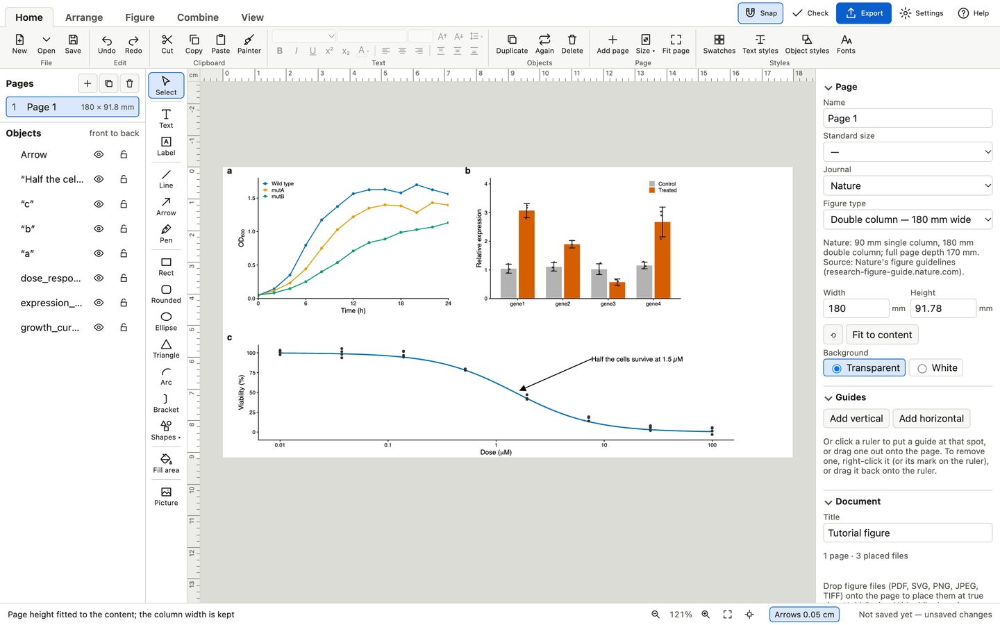

# FigAssemble

**Put together multi-panel scientific figures without losing quality.** Set the page to your
journal's column width, drop in the plots you saved from R (or anywhere else), line them up, add
panel labels, text and arrows, and export a PDF, SVG, PNG or TIFF that a journal will accept.

FigAssemble does the job people usually do in PowerPoint, without PowerPoint's damage:

- **Nothing gets converted on the way.** A PDF you place goes into the exported PDF unchanged; an
  SVG goes into the exported SVG unchanged. PowerPoint's PDF export turns every placed plot into a
  300 dpi bitmap.
- **Plots stay at true size**, so 6 pt text stays 6 pt, and the pre-export check warns you about
  anything smaller than a journal allows.
- **Placed files stay linked.** Re-run your R code and the panel updates by itself. A copy is also
  stored in the document, so it opens complete on a labmate's computer.
- **Journal page sizes** are built in (Nature, Science, Cell, PNAS, PLOS Genetics and more), and
  fonts that R leaves out of its PDFs are embedded when you export.
- **Your PowerPoint figures come along.** Open a `.pptx` and choose its slides, drop a deck on the
  page or the Pages list, or copy slides and shapes in PowerPoint and paste them. Pictures, text,
  lines and shapes come in where they were, as objects you can edit. Pictures are relinked to the
  PDFs and SVGs your R code saved, where they can be found, instead of PowerPoint's copies.
- **Drawing tools like PowerPoint's, and more:** PowerPoint's shapes, arrows whose ends attach to
  objects and follow them, gradient fills, outlines, and fills for areas that lines enclose.
- **Figure tools:** scale bars that stay right when a picture is resized (the scale typed,
  measured, or read from ImageJ and OME-TIFF files), zoom insets, significance brackets, crop to
  shape, clipping masks and Pathfinder.
- **Consistent colours and styles:** linked swatches and text styles (change one and everything
  using it follows), colour-blind-safe palettes, a colour vision preview, and copying a style from
  one object to others.

> **Status: early version, for collaborators' feedback.** "FigAssemble" is a working name.
> Developed and tested on a Mac; Windows should work but hasn't been tried on a real Windows
> computer yet, so please [report anything odd](#feedback).

## Install

You'll need about 2 GB of free disk space and an internet connection. The installer sets up
everything FigAssemble needs, including conda (Miniforge) if you don't have it. The first install
takes 5-15 minutes; nothing else on your computer is changed.

**First, download FigAssemble.** This repository is private, so you need a GitHub account that
Matthew has added to it. Open the [newest release](https://github.com/matthewwdavis/FigAssemble/releases/latest)
and, under **Assets**, click **FigAssemble-…zip** (the one with the version number in its name).

### Mac

1. Open the downloaded ZIP (double-click it in Downloads). You get a folder named after the
   version, such as `FigAssemble-0.2.0`.
2. In that folder, double-click **`install-mac.command`**.
   - If macOS says it can't open it (*"Apple could not verify…"*), click **Done**, open
     **System Settings → Privacy & Security**, scroll down and click **Open Anyway** next to
     `install-mac.command`. (On macOS 14 and older: Control-click the file, choose **Open**,
     then **Open** again.)
   - Or open **Terminal**, type `bash ` (with a space after it), drag `install-mac.command` into
     the Terminal window and press Return.
3. A Terminal window shows the progress. When it finishes, FigAssemble opens. From now on it's in
   your **Applications** folder like any other app.

### Windows

1. Right-click the downloaded ZIP and choose **Extract All**, then open the extracted folder (named
   after the version, such as `FigAssemble-0.2.0`). Run the installer from the extracted folder,
   not from inside the ZIP.
2. Double-click **`install-windows.bat`**. If Windows says it *protected your PC*, click
   **More info**, then **Run anyway**.
3. A window shows the progress. When it finishes, FigAssemble starts. From now on, start it from
   the **Start menu** or the **desktop** shortcut.

**Updating:** FigAssemble updates itself. When a new version is out, it downloads it and installs it
when you quit FigAssemble, then says what's new. **Settings → Updates** switches this to asking
first, or off, and can go back to the version before. While the repository is private,
FigAssemble asks you to sign in to GitHub once, to download updates (see the
[guide](docs/guide.md#updates)). You can delete the downloaded folder after installing.

Installed FigAssemble before it updated itself (version 0.1.0)? Download the newest release and
run its installer once; it keeps your settings, and from then on FigAssemble updates itself.

**Removing it:** see [the user guide](docs/guide.md#removing-figassemble).
**If something goes wrong:** see [Troubleshooting](docs/guide.md#troubleshooting).

## Quick start

1. **Choose a page size.** With nothing selected, the panel on the right shows the page: pick a
   **Journal** and **Figure type** (say *Nature*, *Double column*), or a standard size.
2. **Drop in your plots.** Drag PDF, SVG, PNG, JPEG or TIFF files from Finder or Explorer onto the
   page, copy them there and paste (⌘V), or use **Picture** (I) in the tools on the left. They land
   at true size and stay linked to their files.
3. **Arrange them.** Drag them into place. Magenta lines show when edges and centres line up;
   hold ⌘ (Ctrl on Windows) to drag freely. The **Arrange** tab aligns and spaces several at once.
4. **Label and annotate.** Press **P** and click to add panel labels (a, b, c…). Add text (T) and
   arrows (A). Drop an arrow's end on an object's corner or edge to attach it.
5. **Export.** Click **Check** to look for problems, then **Export** (⌘E) for PDF, SVG, PNG or TIFF,
   or an editable PowerPoint file for collaborators.
   Save your work with ⌘S as a `.figasm` document.

**New to it? Follow the [tutorial](docs/tutorial.md)**: it builds the figure above in about
15 minutes, using the sample plots in [`examples/`](examples). Everything else is in the
**[user guide](docs/guide.md)**, including [all keyboard shortcuts](docs/guide.md#keyboard-shortcuts).

## Keyboard shortcuts

The ones you'll use most. Right-click an object, the page or a page in the Pages list for a menu
of what you can do with it, with the shortcuts alongside.

| Action | Mac | Windows |
|---|---|---|
| Undo, Redo | ⌘Z, ⌘⇧Z | Ctrl+Z, Ctrl+Y |
| Cut, Copy, Paste | ⌘X, ⌘C, ⌘V | Ctrl+X, Ctrl+C, Ctrl+V |
| Duplicate, Delete | ⌘D, Delete | Ctrl+D, Delete |
| Transform again (repeat the last move, resize or turn) | ⌘⇧D | Ctrl+Shift+D |
| Copy style, Paste style | ⌘⇧C, ⌘⇧V | Ctrl+Shift+C, Ctrl+Shift+V |
| Search commands (type to find any command) | ⌘/ | Ctrl+/ |
| Select all | ⌘A | Ctrl+A |
| Group, Ungroup | ⌘G, ⌘⇧G | Ctrl+G, Ctrl+Shift+G |
| Bring forward, Send backward (or drag the object's row in the Objects list) | ⌘], ⌘[ | Ctrl+], Ctrl+[ |
| Move the selection one step (10 steps); the step follows the zoom, as the status bar shows | Arrow keys (with ⇧) | Arrow keys (with Shift) |
| Zoom in, Zoom out, Fit page, True size | ⌘+, ⌘−, ⌘0, ⌘1 | Ctrl+Plus, Ctrl+Minus, Ctrl+0, Ctrl+1 |
| Centre the page | ⌘⇧0 | Ctrl+Shift+0 |
| Save, Open, Export | ⌘S, ⌘O, ⌘E | Ctrl+S, Ctrl+O, Ctrl+E |
| Select, Text, Panel label, Line, Arrow, Rectangle | V, T, P, L, A, R | V, T, P, L, A, R |
| Insert picture | I | I |
| Fill an area that lines enclose | F | F |
| Menu for the selection | Right-click or Control-click | Right-click or Shift+F10 |
| Every shortcut | ? | ? |

All of them are in the [user guide](docs/guide.md#keyboard-shortcuts), and **?** shows them in
FigAssemble.

## Feedback

Feedback is the point of this early version: what's confusing, what's missing, what breaks.

- **[Report a problem](https://github.com/matthewwdavis/FigAssemble/issues/new?template=problem.yml)**: something didn't work, looked
  wrong in the export, or was confusing.
- **[Suggest an idea](https://github.com/matthewwdavis/FigAssemble/issues/new?template=idea.yml)**: something FigAssemble should do, or
  do differently.

Each form asks for the details that help, such as what you did, what you expected and Mac or Windows.
Screenshots help a lot: paste or drag them into the form. The version number is at the bottom of
**Settings**. You can see existing reports under [Issues](https://github.com/matthewwdavis/FigAssemble/issues).

## For developers

Running from source, tests, the editor self-test, screenshots and installers:
[docs/development.md](docs/development.md). Design decisions: [docs/design.md](docs/design.md);
progress: [docs/roadmap.md](docs/roadmap.md).
