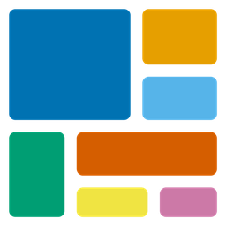
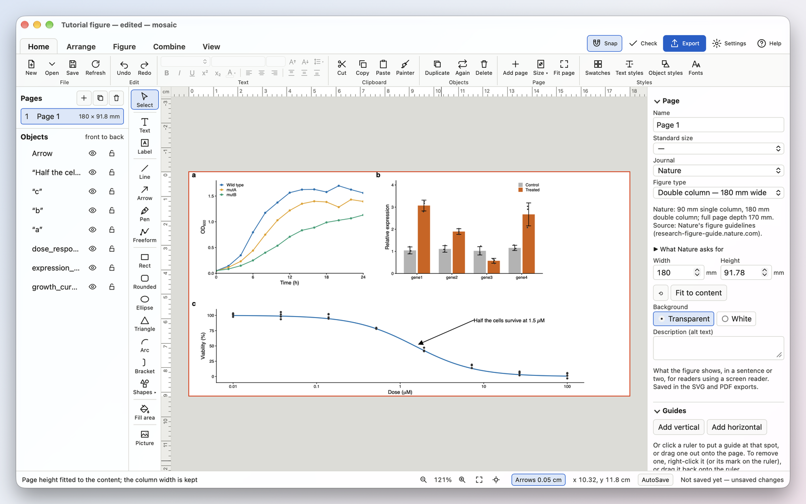

<p align="center">
  
</p>

<h1 align="center">mosaic</h1>

<p align="center">
  <b>Multi-panel scientific figures, journal-ready, without losing quality.</b><br>
  Place the plots you saved from R (or anywhere else) at true size, line them up, label them,
  and export a PDF, SVG, PNG or TIFF that meets your journal's rules.
</p>

<p align="center">
  <a href="https://github.com/matthewwdavis/mosaic/releases/latest"></a>
  <a href="LICENSE"></a>
  
</p>

<p align="center">
  <a href="https://github.com/matthewwdavis/mosaic/releases/latest/download/mosaic.zip">
    <picture>
      <source media="(prefers-color-scheme: dark)" srcset="docs/images/download-dark.svg">
      
    </picture>
  </a>
</p>

<p align="center">
  Free and open source · <a href="#install">How to install</a> ·
  <a href="docs/tutorial.md">Tutorial</a> · <a href="docs/guide.md">User guide</a>
</p>

## How to cite

If mosaic helped make your figures, please cite the version you used:

> Davis, M. (2026). *mosaic* (Version 0.2.0) [Computer software]. https://github.com/matthewwdavis/mosaic

<details>
<summary>BibTeX</summary>

```bibtex
@software{Davis_mosaic_2026,
  author = {Davis, Matthew},
  title = {mosaic},
  version = {0.2.0},
  year = {2026},
  month = {11},
  url = {https://github.com/matthewwdavis/mosaic}
}
```

</details>

In mosaic, **Help ▸ Cite mosaic** copies the reference for the version you have, with BibTeX and
RIS for a reference manager; GitHub's **Cite this repository** button (top right of this page)
gives the same. Releases will get a DOI from Zenodo, to cite instead of the GitHub link once
there is one.

<picture>
  <source media="(prefers-color-scheme: dark)" srcset="docs/images/readme-window-dark.png">
  
</picture>

> [!NOTE]
> mosaic is an early version, made and used mostly on a Mac. On Windows and Linux it's tested
> automatically on every change. [Feedback](#feedback) is very welcome.

## What it does

- **Nothing is converted on the way.** A PDF you place goes into the exported PDF unchanged, and
  an SVG into the exported SVG, so text and lines stay sharp and editable.
- **True size, checked against the journal.** Plots keep their size, so 6 pt text stays 6 pt.
  **Check** compares text sizes, fonts, line widths and picture resolution with the journal's
  rules before you export.
- **Journal sizes built in.** Nature, Science, Cell, PNAS, PLOS Genetics and other journals, plus
  paper, slides and posters. Any other journal can be added from its author guidelines in a minute.
- **Linked files.** Re-run your R code and the panel updates by itself. A copy is kept in the
  document too, so it opens complete on a colleague's computer.
- **Figure tools.** Panel labels, scale bars, zoom insets, significance brackets, arrows that stay
  attached, shapes, equations, crop to shape, colour-blind-safe palettes and a colour vision
  preview.
- **Works with PowerPoint.** Open a `.pptx` or paste slides: pictures, text and shapes come in as
  objects you can edit, relinked to the PDFs and SVGs your code saved. Export an editable
  PowerPoint file for collaborators.

## Install

You'll need about 2 GB of free disk space and an internet connection. The installer sets up
everything mosaic needs, including conda (Miniforge) if you don't have it, and changes nothing
else on your computer. The first install takes 5–15 minutes.

### With one line (easiest)

Paste the line for your computer and press Return. It downloads the newest version and runs the
installer, without the security warnings a downloaded file gets. Run it again any time to
reinstall or update.

**Mac or Linux:** in **Terminal** (on a Mac, Applications ▸ Utilities ▸ Terminal):

```bash
curl -fsSL https://raw.githubusercontent.com/matthewwdavis/mosaic/main/install.sh | bash
```

**Windows:** in **PowerShell** (type *PowerShell* in the Start menu):

```powershell
irm https://raw.githubusercontent.com/matthewwdavis/mosaic/main/install.ps1 | iex
```

### Or download and double-click

**[Download mosaic](https://github.com/matthewwdavis/mosaic/releases/latest/download/mosaic.zip)**
(always the newest version; one ZIP for every computer; all versions are on the
[releases page](https://github.com/matthewwdavis/mosaic/releases)), then:

<details>
<summary><b>Mac</b></summary>

1. Open the downloaded ZIP. You get a folder named after the version, such as `mosaic-0.2.0`.
2. In that folder, double-click **`install-mac.command`**.
   - If macOS says it can't open it (*"Apple could not verify…"*), click **Done**, open
     **System Settings ▸ Privacy & Security**, scroll down and click **Open Anyway** next to
     `install-mac.command`. (On macOS 14 and older: Control-click the file, choose **Open**, then
     **Open** again.)
   - Or open **Terminal**, type `bash ` (with a space after it), drag `install-mac.command` into
     the window and press Return.
3. A Terminal window shows the progress. When it finishes, mosaic opens. From then on it's in your
   **Applications** folder like any other app.

</details>

<details>
<summary><b>Windows</b></summary>

1. Right-click the downloaded ZIP, choose **Extract All**, and open the extracted folder (named
   after the version, such as `mosaic-0.2.0`). Run the installer from there, not from inside the
   ZIP.
2. Double-click **`install-windows.bat`**. If Windows says it *protected your PC*, click
   **More info**, then **Run anyway**.
3. A window shows the progress. When it finishes, mosaic starts. From then on, start it from the
   **Start menu** or the **desktop** shortcut.

</details>

<details>
<summary><b>Linux</b></summary>

1. Extract the downloaded ZIP and open a terminal in the extracted folder (named after the
   version, such as `mosaic-0.2.0`).
2. Run **`bash install-linux.sh`**. Nothing is installed system-wide and no password is asked for.
3. When it finishes, mosaic starts. From then on it's in your applications menu, and `mosaic`
   starts it from a terminal.

To paste pictures copied in other programs, mosaic uses `wl-clipboard` (Wayland) or `xclip`
(X11); install one with your package manager if neither is there. On a computer without a
desktop (a cluster login node, say), `mosaic gui --browser` runs it in your web browser (see the
[guide](docs/guide.md#in-a-web-browser)).

</details>

**Updates:** on a Mac and on Windows, mosaic updates itself when you quit it, then says what's
new (**Settings ▸ Updates** switches this to asking first, or off). On Linux, run the one line
again. See also [Troubleshooting](docs/guide.md#troubleshooting) and
[Removing mosaic](docs/guide.md#removing-mosaic).

## Get started

The first time mosaic opens it shows a sample figure to try things on (**Help ▸ Open the Sample
Figure** brings it back).

1. **Choose a page size.** **Size** in the Home tab: a journal's figure size (say *Nature*,
   *Double column*), paper, a slide or a poster.
2. **Drop in your plots.** Drag PDF, SVG, PNG, JPEG or TIFF files onto the page, or paste them.
   They land at true size and stay linked to their files.
3. **Arrange them.** Drag them into place; magenta lines show when edges and centres line up.
   The **Arrange** tab aligns and spaces several at once.
4. **Label and annotate.** Press **P** and click to add panel labels (a, b, c…), **T** for text,
   **A** for arrows.
5. **Check and export.** **Check** looks for problems, then **Export** (⌘E) saves PDF, SVG, PNG,
   TIFF or PowerPoint. Save your work with ⌘S as a `.mff` file.

**[The tutorial](docs/tutorial.md)** builds the figure above in about 15 minutes, using the sample
plots in [`examples/`](examples). Everything else is in the **[user guide](docs/guide.md)**,
including [every keyboard shortcut](docs/guide.md#keyboard-shortcuts) (or press **?** in mosaic).

## Feedback

- **[Report a problem](https://github.com/matthewwdavis/mosaic/issues/new?template=problem.yml)**:
  something didn't work, looked wrong in the export, or was confusing.
- **[Suggest an idea](https://github.com/matthewwdavis/mosaic/issues/new?template=idea.yml)**:
  something mosaic should do, or do differently.

**Help ▸ Report a Problem** in mosaic saves a small report to attach: mosaic's version, your
operating system, your settings and its recent log, with none of your figures or file names.
Screenshots help a lot.

## Papers using mosaic

None listed yet. Published a paper or preprint with figures made in mosaic?
**[Add it here](https://github.com/matthewwdavis/mosaic/issues/new?template=paper.yml)** and it
will be listed in this section.

## License

The code is under the [MIT License](LICENSE); the documentation, pictures and example plots are
under [CC BY 4.0](LICENSE-docs). Parts that come from others are listed with their notices in
[THIRD_PARTY_NOTICES.md](THIRD_PARTY_NOTICES.md).

## For developers

Running from source, tests, the editor self-test, screenshots and installers:
[docs/development.md](docs/development.md). Design decisions: [docs/design.md](docs/design.md);
progress: [docs/roadmap.md](docs/roadmap.md).
