# mosaic user guide

Everything mosaic does, by topic. New to it? Start with the [tutorial](tutorial.md).
Shortcuts are written for a Mac; on Windows use **Ctrl** for **⌘** and **Shift** for **⇧**.

- [The window](#the-window)
- [Pages and page sizes](#pages-and-page-sizes)
- [Pictures](#pictures)
- [Text and panel labels](#text-and-panel-labels)
- [Equations](#equations)
- [Lines and arrows](#lines-and-arrows)
- [Shapes](#shapes)
- [The pen and editing points](#the-pen-and-editing-points)
- [Area fills](#area-fills)
- [Dashes](#dashes)
- [Connecting lines to objects](#connecting-lines-to-objects)
- [Moving, sizing and arranging](#moving-sizing-and-arranging)
- [The Objects list](#the-objects-list)
- [Symbols](#symbols)
- [Right-click menus](#right-click-menus)
- [Align and distribute](#align-and-distribute)
- [Rulers, guides, grid and snapping](#rulers-guides-grid-and-snapping)
- [Checking and exporting](#checking-and-exporting)
- [Saving, linked files and recovery](#saving-linked-files-and-recovery)
- [PowerPoint slides](#powerpoint-slides)
- [Settings](#settings)
- [Updates](#updates)
- [Keyboard shortcuts](#keyboard-shortcuts)
- [Accessibility](#accessibility)
- [Command line](#command-line)
- [Troubleshooting](#troubleshooting)
- [Removing mosaic](#removing-mosaic)

## The window


1. **Tabs** across the top, like PowerPoint's ribbon:
   - **Home**: New, Open, Save; Undo, Redo; **Text** (font, size, colour, alignment and more: see
     [Text and panel labels](#text-and-panel-labels)); Cut, Copy, Paste, Painter; Duplicate,
     Again, Delete; Add page, Size, Fit page; Swatches, Text styles, Object styles, Fonts.
   - **Arrange**: Align, Distribute, Spacing, Align to, Match size, Group and Grid, Order (see
     [Align and distribute](#align-and-distribute)).
   - **Figure**: scale bars (Scale bar, Measure), zoom insets, significance brackets (Bracket,
     Stack), [symbols](#symbols) (Make symbol, Symbols…), [equations](#equations) and the
     [figure report](#checking-and-exporting).
   - **Combine**: Pathfinder (Unite, Minus front, Intersect, Exclude) and clipping masks (Make mask,
     Release).
   - **View**: Zoom, Fit and Centre page; show or hide the Rulers, Grid and Guides; grid Settings;
     a colour vision preview, and the page with each one side by side (Check colours).
2. Each tab's commands, in labelled groups.
3. **Always in view:** **Snap** (on when highlighted), **Check**, **Export**, **Settings**, **Help**.
4. **Pages** of the document, and **Objects** on the current page, front to back. Each object has
   buttons to hide or lock it; click one to select it, or drag it to put it in front of or behind
   others (see [The Objects list](#the-objects-list)).
5. **Drawing tools**, beside the page.
6. **The page**, with rulers along the top and left.
7. **Properties** of the selection: its **X, Y, Width and Height** at the top, in view whatever
   tab is open, then tabs: **Arrange** (rotation, alignment, connections), **Style** (shape,
   fill, line, arrowheads, outline), **Text**, **Picture**. With nothing
   selected, it shows the page, its guides and the document. Click a section heading to fold it;
   folded sections stay folded, and each kind of object opens on the tab you used last.
8. **Status bar:** messages, zoom, how far the arrow keys move a selection (click it to switch
   between following the zoom and a fixed 1 pt), the pointer's position, and whether the
   document is saved.

**Panel widths:** drag the inner edge of either side panel to make it wider or narrower (or
focus the edge and use the arrow keys). Double-click the edge to put the panel back. mosaic
remembers the widths.

**Selection:** the box around a selected object, and its handles, stand a few pixels outside the
object, so you can see the object's own edges while you move and resize it.

**The menu bar** (Mac): along the top of the screen, as for any Mac app.
- **mosaic:** About mosaic, Settings… (⌘,), Hide, Quit.
- **File:** New, Open…, Open Recent, Close, Save, Save As…, Export…, Check Before Export…, Figure
  Report…. New and Open open a window of their own (see
  [Saving](#saving-linked-files-and-recovery)), and the menus work in the window in front.
- **Edit:** Undo, Redo, Cut, Copy, Paste, Paste as Picture, Duplicate, Transform Again, Delete,
  Select All, Select Same, Copy Style, Paste Style. While you type in a box, they work on its
  text.
- **View:** zoom, Fit Page and Centre Page; Rulers, Grid, Guides and Snap, ticked when on; the
  colour-vision preview, and Side by Side…; full screen.
- **Window** and **Help:** Minimize and Zoom; keyboard shortcuts and help, Search Commands…, the
  user guide, and Report a Problem… or Suggest an Idea…. Help's search box finds any menu command.

Each menu command shows its shortcut. While a dialog is open, the menus wait, as the keys do.

**Command search (⌘/):** type a few letters of what you want, such as "align", "swatch" or
"rulers", and press Enter to run the command (the arrow keys choose another). Each one shows its
shortcut, so it's also a way to learn them. "Colour blind" (or "color blind") finds the colour
vision previews.

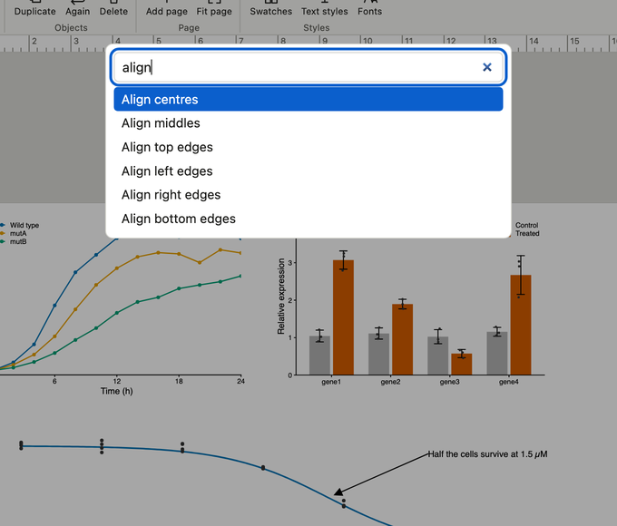

The Objects list and properties panel are real form controls, usable from the keyboard and with
screen readers (see [Accessibility](#accessibility)).

## Pages and page sizes

With nothing selected (click the grey area or press Escape), the right panel shows the **Page**.

- **Standard size**:
  - **Paper:** A4 or US Letter.
  - **Slides:** 16:9 (PowerPoint's default, 33.87 × 19.05 cm), 4:3 (25.4 × 19.05 cm) or 16:10
    (25.4 × 15.88 cm).
  - **Posters:** 48 × 36 in, or A0 (84.1 × 118.9 cm). Swap width and height turns either around.

  New documents are A4, or the size chosen in Settings (**New documents**). New pages take the
  size of the page they're added after.
- **Journal** and **Figure type**: sets the page to that journal's column width and its greatest
  figure depth, e.g. Nature double column, 180 × 170 mm. Built in: Cell, G3, Genetics, Genome
  Biology, Genome Research, Heredity, Horticulture Research, Molecular Biology and Evolution,
  Molecular Plant, Nature, New Phytologist, Plant Cell, PLOS Genetics, PNAS, Science and The
  Plant Journal. The note below says where each size comes from. Some journals don't publish sizes; for those the sizes
  were measured from a recent published article, and the note says so.
  - A journal also gives the page's panel labels its look (see
    [Text and panel labels](#text-and-panel-labels)), Check judges the page by its rules (text
    sizes and fonts, line widths, pictures' resolution), and Export says which files it takes.
    **What … asks for**, below the size, opens to say what the journal asks for and where
    each rule comes from.
- **Width** and **Height**: any size. The button beside them swaps width and height.
- **Fit to content** (also **Fit page** in the Home tab): crops the page to what's on it, with
  no margin (objects parked wholly off the page don't count). On a journal page it keeps the column
  width and fits only the height.
- **Background**: transparent (the default, which journals prefer) or white.

**Size** (Home tab) offers the same sizes whatever is selected, with every journal's figure sizes
under **Journal**, then **Swap width and height** and **Custom size…** to type the width and
height. The page's size now has a tick.

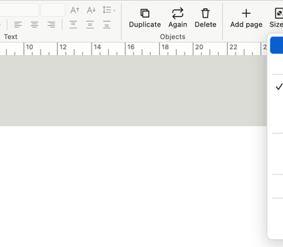

**Around the page:** the grey area around the page works like the page. Scroll out to it, then
click, drag and resize objects there, draw there, and drop or paste pictures there. An object can
stick out past the page's edge, or sit wholly off the page as a place to keep things for later; it
saves with the document. Exports show only the page: anything past its edges is cut off there,
and objects wholly off the page are left out (PowerPoint export too). A click picks an object
anywhere it shows, its line's or border's outer half included.

**Pages:** the + button above the Pages list adds a page with the same size, background and
guides. The other buttons duplicate or delete the current page. Deleting the only page leaves an
empty page of the same size, background and guides in its place (a page with objects asks first;
⌘Z brings it back). Drag a page up or down the list to move it (the others slide apart to make
room), and double-click a page's name to rename it. Drop a PowerPoint deck in the list to add its
slides as pages there. One document can hold versions of a figure side by side.

**Pages between documents:** drag a page out of the Pages list into another mosaic window to
copy it there (on a Mac). Over that window's Pages list a line shows where it will go; over its
page, it goes after the page showing (taking a blank page's place). The page stays in the first
document too, and its pictures, swatches, symbols and styles come with it, as when you drop a
whole `.mosaic` file.

## Pictures

**Placing:** drag PDF, SVG, PNG, JPEG or TIFF files onto the page, or click **Picture** (I), or
copy the files in Finder or Explorer and paste them (⌘V). They land at **true size**, exactly as
the file says. Several files at once arrive in a cascade. Dropped on a page in the Pages list,
they go on that page. A PowerPoint deck dropped on the window brings in its slides instead (see
[PowerPoint slides](#powerpoint-slides)), and a mosaic document its pages (see
[Saving](#saving-linked-files-and-recovery)).

**Pasting** (⌘V, the Paste button, or right-click → Paste to paste where you clicked) takes
whatever was copied last:

- **Objects** copied in mosaic, in this document or another.
- **Files** copied in Finder or Explorer: placed linked, as if you'd dropped them.
- **Slides and shapes** copied in PowerPoint: as objects you can edit, where they were on the slide
  (see [PowerPoint slides](#powerpoint-slides)).
- **A picture** copied in another app, such as a screenshot or an image copied from a browser,
  at true size (its recorded resolution, or 300 dpi if it has none), stored in the document. On
  a Mac, shapes and drawings copied from Illustrator, Keynote or Preview arrive as a vector PDF,
  so they stay sharp. On Windows these arrive as a bitmap.
- **Text** as a text box in your default font and size (Settings → New objects), keeping bold,
  italic and line breaks.

Some apps copy text and a picture together (Word, Excel, PowerPoint). ⌘V then pastes the text, or
PowerPoint's slides and shapes as objects; right-click and choose **Paste as picture** for the
picture instead.

- **Linked and stored:** a placed file stays **linked**, so when the file changes (you re-run your
  R code and it saves under the same name), the picture updates within a couple of seconds. It
  keeps its place and its scale, so a plot saved larger gets larger on the page, from its top-left
  corner. Undo (⌘Z) puts back the version before, which then stays until the file is saved again.
  That undo asks first, naming the pictures it would roll back, so a run of ⌘Z can't undo an
  update by mistake: **Roll back** rolls them back, **Cancel** keeps the update.
  A copy is also stored in the document, so it opens complete anywhere. Hold **Option (Alt)**
  while dropping to store a copy without the link.
- **Copies:** if a plot was saved as PDF, SVG and PNG under one name, mosaic finds them all.
  Each export uses the matching copy unchanged:

  | Placed as | PDF export | SVG export | PNG / TIFF export |
  |---|---|---|---|
  | PDF | the PDF page, unchanged | converted to SVG, only if there's no SVG copy | drawn once from the vectors |
  | SVG | converted to PDF, only if there's no PDF copy | the SVG, unchanged | drawn once from the vectors |
  | PNG, JPEG, TIFF | the image data, unchanged | embedded, unchanged | resampled once to the export resolution |

The **Picture** tab of a selected picture shows its file, whether the link works, the copies found,
and its **scale**. A picture that isn't at 100% says so, with a warning that its text has shrunk
or grown. One stretched unevenly, its frame a different shape from the file (PowerPoint can leave
pictures like that), gives its scale across and down, such as "98.8% across, 90% down", with a
warning that its text and curves are distorted. Its buttons:

- **Crop**, or double-click the picture, or press Enter: drag the edges to crop, or drag the
  picture to move it inside its frame. Press Enter or Escape when done. **Reset crop** undoes it.
- **100%** puts it back to true size, both ways, so a stretched picture gets its proportions back
  too. Its top-left corner stays where it is.
- **Crop to shape**, as in PowerPoint: the picture shows only inside a shape fitted to its frame
  (a circle, a rounded rectangle, a star…), with the shape's adjustments (a rounded rectangle's
  corner radius, say). Crop moves the picture within the shape; **None** takes it away. The
  shape clips the picture in every export, which still uses the picture's own PDF or SVG.

  
- **Border** draws a line round the picture (round its crop shape, if it has one), in any colour
  and thickness.
- **Export from** forces one copy (always the PDF, say) instead of the best copy for each format.
- **Kind** (a PNG, TIFF or JPEG with no PDF or SVG copy): **Photo**, **Photo with text or lines**
  or **Line art (graphs, drawings)**. Journals ask for more resolution for line art than for
  photos (Cell: 300 dpi for photos, 1,000 for line art), and some want line art as vector files
  rather than pictures; Check goes by the kind. **Automatic**, the default, is mosaic's guess from
  the picture's pixels, and says what it guessed (a labelled photo saved as JPEG can pass for a
  plain one).
- **Replace…** swaps in another file, keeping the position and scale. Shift-drop a file onto a
  picture does the same.
- **Show file** reveals the linked file in Finder or Explorer.
- **Unlink** stops following the file and keeps the stored copy.

Its position and size (proportions kept) are at the top of the properties panel; the Arrange tab
has its rotation, flips and **Transparency**.
For screen readers, give each picture a **Description** in the Object section.

### Dangerous mode: editing a plot's own text

Turn on **View ▸ Dangerous Mode** in the Mac menu bar, **Dangerous** in the ribbon's View tab, or
find it with command search (⌘/). It stays on in that window until you turn it off, and mosaic
always opens with it off. While it's on, a red **⚠ Dangerous mode** badge sits in the status bar;
click it to turn it off.

In dangerous mode, the texts of a placed PDF or SVG are outlined in red as the pointer passes
over it, the one under the pointer solid. **Double-click** a text to lift it out of the plot: it
becomes an ordinary text box in the same font, size, colour, angle and place, ready to type in,
and the plot is drawn without it. From then on it's like any other text box: change its words,
font, size, colour or weight, move it, or delete it (the plot still leaves it out). It moves,
scales and turns with its picture. A double-click that misses the text crops the picture as usual.

- **The file never changes.** The picture is shown and exported from a copy without the texts
  you lifted, and the file you placed stays in the document as it was. Right-click a lifted text
  box and choose **Put back in plot** to delete it and show the plot's own text again;
  **Restore plot text** (right-click the picture, or its Picture tab) puts them all back.
- **Each placed copy has its own edits.** A copy of the picture made without its lifted boxes
  shows the plot's own text.
- **When R saves the file again,** the same texts are lifted out of the new file wherever they're
  still there, in the same words, size and place. An edit whose text has changed or moved (a new
  axis title, say) is dropped: its box goes, the status bar says so, and the Picture tab and
  **Check** list what it said. Undo (⌘Z) brings back the older version with the edits.
- R lays out a plot's PDF and SVG copies slightly differently (by up to about 1 pt), because it
  measures text differently for each. Texts are lifted from the copy mosaic shows, usually the
  SVG, so in a PDF export a lifted text can sit up to about a point from where the plot's own was.
- Lifted text is kerned with the installed font's pairs, which aren't quite R's (see
  [Kerning](#text-and-panel-labels)), so a lifted title can come out a fraction of a point longer
  than R drew it.
- Letters a program saved as outlines can't be lifted, nor can text in a flipped picture or an
  equation. A zoom inset of the picture shows the plot's own text.
- Check notes every picture with text lifted out, so it's never a surprise in a figure you send.

## Scale bars

A scale bar shows a real length on a photograph or micrograph, and stays right when the picture is
resized or cropped.

1. **Give the picture a scale** in its Picture tab's **Scale** section, in any of three ways:
   - **From the file:** microscope images saved by ImageJ/Fiji or as OME-TIFF carry their pixel
     size, and mosaic uses it when you place them (the section says "from the file").
   - **Type it:** the size of one pixel (e.g. 0.65 µm) and its unit. For a PDF or SVG, it's the
     length of one point of the original.
   - **Measure it:** click **Measure…** (or **Measure** on the Figure tab), drag along something of
     known length in the picture (a scale bar already in it, a ruler, a stage micrometer), and type
     its real length, such as `100 µm`.
2. **Add the bar:** **Add scale bar** (Picture tab), or **Scale bar** on the Figure tab with the
   picture selected. It starts a round length (1, 2 or 5 times a power of ten) about a fifth of the
   picture's width, just inside its bottom right corner: white on photographs and micrographs,
   black on plots.

The bar's own tab sets its length and unit (**Round length** picks one for you), the label above,
below or none, its colour (swatches too), thickness, text size and bold. Drag it where you want
it: it moves with its picture, keeping its place relative to the corner it's set to stay with,
and its length follows the picture's size, crop and scale.

## Zoom insets

A zoom inset shows part of a picture enlarged beside it, joined to a box on the picture by two
lines. Select the picture, click **Zoom inset** on the Figure tab, and drag a box on the picture
around the area to enlarge.


- **The inset** is a copy of the picture showing what's in the box, three times as big, to the
  picture's right (or below it when the page has no room). It's the picture's own PDF or SVG,
  so it stays sharp in every export. Drag it anywhere; resize it to enlarge more or less. Its
  height always follows the box's shape, so the picture is never stretched.
- **The box** can be dragged or resized to show another area, and the inset follows. When the
  picture moves, is resized or is cropped, the box stays over the same part of it.
- **The lines** run along the outside of the box and the inset, wherever you put them: from corner
  to corner for rectangles, and touching rounded corners and ellipses.
- All three start in Okabe-Ito orange, which shows on dark images and white pages alike; change
  each one's colour and thickness as usual. A scale bar works on an inset too.
- **Shapes:** **▾** beside **Zoom inset** offers a rounded rectangle, an ellipse and a circle as
  well as the rectangle a plain click makes (command search has them too). A circle stays round
  however you resize it. To change the shape later, use **Zoom shape** in the Zoom inset section of
  the box's panel (Arrange tab) or the inset's (Picture tab). A rounded rectangle's **Corner
  rounding** starts at 20%, the same share of each one's size, so the inset's corners are the box's
  enlarged.
- **Same shape:** the box and the inset share their shape. Untick **Same shape as the inset** (or
  **…as the box**) to give one a shape of its own, such as a circle on the picture with a
  rectangular inset. The inset keeps the box's proportions, so it's round only when the box is.
  Tick it again and the other one takes its shape.

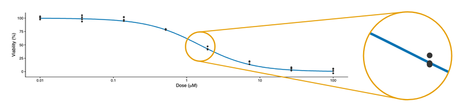

## Significance brackets

A significance bracket marks a comparison: a bar with a tick at each end and a label beyond it.
Click **Bracket** on the Figure tab and drag across the bars it compares; the bar goes at the
height you drag at, with the label above. Drag upright instead for one with its label to the right
(for a chart with horizontal bars).

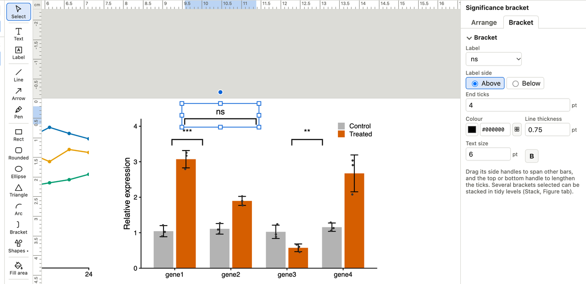

- **Its tab:** the **Label** (`*`, `**`, `***`, `****`, `ns`, or **Other text…** such as a
  p-value), the side the label is on, the end ticks' length, colour (swatches too), line
  thickness, text size and bold. The ends are round and the corners square, and the bar stays put
  when the label or its size changes.
- **On the page:** drag its side handles to span other bars, and the top or bottom handle to
  lengthen the ticks.
- **Stack** (Figure tab, or the panel with several selected) tidies brackets pointing up into
  levels: the narrowest lowest, brackets that don't overlap side by side on one level, and each
  level just above the one below. Their ends stay where they are.

## Text and panel labels

- **Text (T):** click to type, or drag to make a box the text wraps in. Press **Escape** when
  done. Double-click any text, or select it and press Enter, to edit it again. In the editor, ⌘B,
  ⌘I and ⌘U make the selected words bold, italic or underlined, and ⌘⇧= and ⌘= superscript or
  subscript (as in PowerPoint); Shift+Return starts a new line. With text boxes selected rather
  than typed in, ⌘B, ⌘I and ⌘U change all their text.
- **Text** in the Home tab, two rows like PowerPoint's: text style, font, size, **Bigger** and
  **Smaller** (⌘⇧> and ⌘⇧<, through 5, 5.5, 6, 6.5… pt), line spacing; bold, italic,
  underline, superscript, subscript, colour (swatches, or any colour), left, centre or right, and
  top, middle or bottom of the box.
  - With text boxes selected, one or several, it changes all their text. It shows what they
    share: a blank font or size means they differ.
  - While you type, it changes only the selected words, or with none selected what you type next.
    Alignment, line spacing and text styles go to the lines the selected words are in. Each change
    is an undo step of its own: ⌘Z straight after one takes it back, and you carry on typing.
  - Selecting a text box shows the Home tab. Once no text is selected, the tab you were on comes
    back, unless you picked another tab meanwhile. Settings turns this off (**Show the Home tab
    while text is selected**). Two or more text boxes show the Arrange tab instead (see
    [Align and distribute](#align-and-distribute)); the Text section still works on them all.
  - Shapes with text in them, and scale bar and bracket labels, are set in their properties
    instead.

  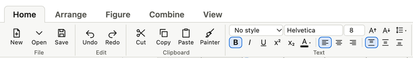

- **Superscript and subscript** (x² and x₂ on the Text tab) work on the selected words while you
  type, or on the whole box otherwise.
- **Symbols** (Text tab): µ, °, ±, ×, arrows, ⇌, ‰, primes, Å and the Greek letters, put in where
  the cursor is while you type, or at the end of the selected text box otherwise.
- The properties panel's **Text** tab sets the font, size (in points), colour, bold, italic and
  underline for the whole box (while you type in it too), and alignment, vertical position,
  wrapping, **Resize the box to fit the text** and **Kerning**.
- **Kerning** sets letter pairs such as "To", "AV" and "Ty" closer, by as much as the font says
  (its own kerning table). New text is kerned, at every size; text made before mosaic kerned
  (November 2026) keeps its spacing until you tick **Kerning** on its Text tab. Text from a
  PowerPoint deck keeps PowerPoint's own setting, which by default kerns only text of 12 pt and
  more. PowerPoint export carries each box's setting, so PowerPoint spaces it the same way.
  - mosaic kerns with the installed font's pairs. Fonts differ: your Mac's Helvetica sets 105
    pairs, mostly capitals, while R's PDFs use Adobe's Helvetica metrics, which set more pairs
    and closer. So text lifted out of an R plot in
    [dangerous mode](#dangerous-mode-editing-a-plots-own-text) can still be spaced slightly
    differently from R's.
- **Panel label (P):** click to add the next free letter (a, b, c…) in bold 8 pt Helvetica, or
  in the look of the page's journal. Settings changes the size and case.
  - **A journal's look:** a page with a journal's size (Page panel or **Size**) gives its panel
    labels that journal's style: capitals or lowercase, brackets (New Phytologist's (a)), font,
    size and bold. It comes from the journal's guidelines, or, where they don't say, was measured
    in figures the journal has published. The Page panel says which (**What … asks for**).
  - Choosing the journal restyles the labels already on the page, as one undo step: the Label
    tool's, and any text box that's just a letter (a, (b), C.), as labels from PowerPoint are.
  - Switching to another journal restyles them again, but keeps what you've changed by hand in a
    label (one made bigger, say). New labels follow the journal.
  - A label put on or near a picture or group (within about 5 mm) stays with it, by the panel's
    nearest corner: it goes with the panel when the panel moves or changes size, and moves just
    once when you move both together. Selected, it shows its panel dashed and a line to the
    corner it keeps.
  - Drag it to another corner of its panel and it keeps that corner; drag it onto another panel
    and it stays with that one instead.
  - **Detach** (its Arrange tab, or right-click) lets it go, so it stays put when the panel moves;
    **Attach to the panel** there attaches any text box on or next to a picture or group.

  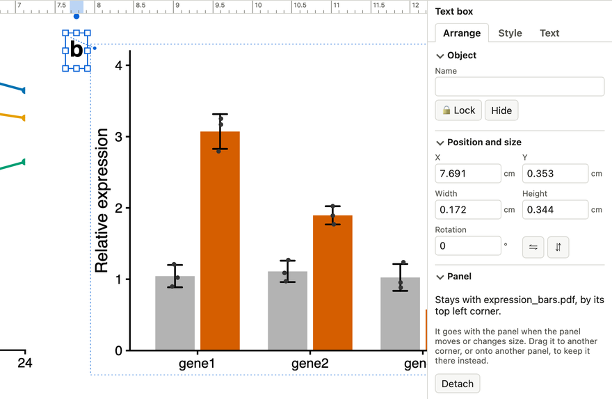

- Any shape can hold text: double-click it to type.
- **Text styles** keep text alike: **New style from this text…** on the Text tab names the selected
  text's format (font, size, colour, bold, italic, underline, alignment, spacing), and **Text
  style** gives a style to other text. Text using a style follows it:
  - To change a style, format one text the way you want and click **Update the style to match**.
    Every text using the style changes, but anything you changed by hand in a text (say, one label
    made bigger) stays. The Text tab says when a text differs from its style; **Clear changes**
    puts it back.
  - A style named **Panel label** is used for new panel labels.
  - **Text styles** (Home tab) renames and deletes styles, with what each looks like and how much
    text uses it. Deleting a style keeps the text's format.
- **Fonts** (Home tab, or **Fonts…** in Check) lists every font the figure's text uses, how many
  text objects use each, and whether it's on this computer (one that isn't is drawn with a
  stand-in). Type another font beside one and click **Replace** to swap it on every page, e.g.
  Arial from old slides for Helvetica. Text inside placed pictures keeps its own fonts.

Helvetica is used if you have it, Arial otherwise (it has the same letter widths). Text stays
real text in PDF and SVG exports, with the fonts embedded.

## Equations

**Equation** (Figure tab) draws maths written as in LaTeX, such as `\frac{\Delta F}{F_0}`,
`\mathrm{OD}_{600}` or `y = \alpha e^{-kt}`, with matplotlib's mathtext (which reads most of
LaTeX's maths, not whole LaTeX documents).

- It's placed as a picture with a PDF copy and an SVG copy of the same size, and its text is
  real text: the PDF holds its fonts, so the check measures it and PDF and PNG exports print it
  exactly. An SVG export names its fonts, so they need to be on the computer that opens it.
- Its **Equation** tab sets the **maths**, the **text size** (the figure's default to start with),
  the **colour** and the **font**: the figure's own font (Helvetica unless changed), with
  symbols it lacks from STIX Sans, or **Computer Modern**, as in LaTeX. Each change draws it
  again from the same corner, at the same scale. Double-click it (or press Enter) to change its
  maths.
- Resizing it scales its text, like any picture; the tab says what size its text prints at, and
  **100%** puts it back.
- Maths that can't be read leaves the equation as it was and says what's wrong.

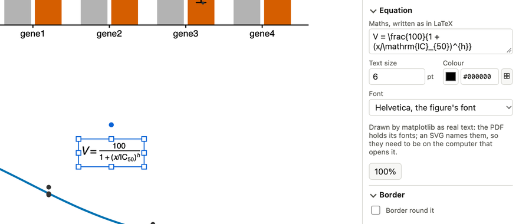

## Lines and arrows

- **Line (L)** and **Arrow (A):** drag from start to end, or click for a 2 cm line. Hold **Shift**
  to keep to multiples of 45°.
- **Curves:** select a line and drag the hollow handle halfway along it: it bends into a smooth
  curve through that point, and an arrowhead follows the curve. Drag other hollow handles to add
  more points (S-curves). Drag points to reshape it; double-click a point to remove it, or the
  line to add one. The **Points** section lists every point's position and switches between
  **Smooth curve** and **Straight segments**.
- **Style** tab: colour, width (in points), [dash](#dashes), line ends (round, flat or square),
  corners, transparency. Every list there shows a small picture of each choice (see
  [Shapes](#shapes)).
- **Arrowheads:** each end can be none, triangle, stealth, open arrow, circle or diamond, small
  to large. **Rounding** (0-100%) rounds a pointed head's tip, which still ends exactly on the
  line's end. **Swap ends** swaps them.
- **Pathway ends:** **Bar** (inhibition, ⊣), **Half arrow** (one barb, on the left of the way the
  line goes, so two lines in opposite directions make ⇌), **Open circle** and **Open triangle**
  (catalysis and stimulation in SBGN). The line stops at an open circle's or triangle's edge, so
  it doesn't show inside.
- **Outline** ([see Shapes](#shapes)) draws a band of another colour around the line and its head.

## Shapes

- **Tools beside the page:** Rectangle (R), Rounded rectangle (U), Ellipse (O), Triangle, Arc,
  Bracket. Drag to draw (Shift for squares and circles), or click for a 2 cm shape. With the
  keyboard: choose a tool and press Enter to place one in the middle of the view.
- **Shapes menu (S):** PowerPoint's shapes in groups: rectangles, basic shapes, block arrows,
  stars, brackets and braces, equation symbols. Arrow keys move through it, typing a name jumps
  to it, Enter chooses.

  

- **Yellow handles** adjust a shape the way PowerPoint's do (a rounded rectangle's corners, a
  star's inner radius, a block arrow's head). The **Shape** section of the Style tab names each
  adjustment so you can type it, and can change one shape into another.
- **Corner rounding** (0-100%) rounds every straight-edged shape's corners (triangles, polygons,
  stars, arrows). 100% is as round as the shape allows; a triangle becomes a circle.
- **Fill**: none, a colour with transparency, or a gradient. Every colour has a picker and a hex
  code (`#1A2B3C`) you can type or paste.
  - **Linear gradient**: a blend at any angle (90° runs top to bottom).
  - **Radial gradient**: circles from the middle or a corner, out to the far corner.

  A gradient has two or more **colour stops**, each with a position along it and its own
  transparency. **Add stop** puts one in the widest gap; **Reverse** swaps the ends. Gradients
  from PowerPoint slides come in as they were.

  **Fill reaches** sets where the fill stops against the shape's line: its **middle** (the
  default), its **inner edge** or its **outer edge**. The difference shows only where the line
  lets you see the fill's edge: in the gaps of a dashed or dotted line, or through a see-through
  one. With **Inner edge** the gaps are empty across the line's whole width; with **Outer edge**
  they're filled across it. For a solid line it's greyed out. PowerPoint export takes such a shape
  as an exact picture.
- **Outline around it**: a band in a second colour around everything the object draws, e.g. a white
  edge that keeps a black arrow visible on a photo. You set its thickness and transparency, and
  where it goes with two lists, offered on every object:
  - **Sides**, on something with an inside (a fill, or a line that goes all the way round):
    **Outside** (only outside the shape), **Inside** (only inside it, over any fill) or **Both
    sides** (along both sides of the line, or with no line, a band along the fill's edge, half
    over it).
  - **Sides**, on a line or an open shape such as an arc or a bracket: **Left side** or **Right
    side** (one side of the line, going from its start to its end) or **Both sides**.
  - **Gaps**: **Filled**, the band runs on through the gaps between dashes, or **Empty**, it goes
    only round each dash or dot. On a solid line it's greyed out, since it changes nothing until
    the line is dashed or dotted.
- **Make editable curve** (arcs): turns an arc into a curve with points you can drag.

**Pictures of the choices:** each list in the Style tab (the shape, fill, line, dash, ends,
corners, arrowheads and their size, the outline's sides and gaps, a connector's route) shows its
choice as a small picture beside its name. Click it, or press ↓, for a menu with a picture of
every choice, in the object's own colours and line width: an arrowhead or an outline looks
there exactly as it will on the page. Dashes are drawn 2 pt thick whatever the line's width, so
dots show and the styles are easy to tell apart. A colour too faint to see against the menu is
shown grey instead: a black line in a dark theme, a white or pale yellow one in a light theme.
The corners are drawn on a thick line's outline, so you can see whether its corner is square
(Sharp), rounded (Round) or cut across (Bevelled). A list greyed out changes nothing yet, and
says why underneath (an arrowhead's size before there's an arrowhead, say).

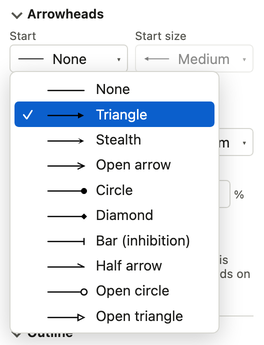

## The pen and editing points

The **Pen** (B, beside the line tools) draws freeform paths and shapes, as in Illustrator:

- Click to place a corner; press and drag to pull out a smooth point's handles (the curve
  follows them).
- Click the first point to close the shape. Press **Enter** or **Escape**, or double-click, to
  finish an open path; **Backspace** takes back the last point.
- An open path of corners only becomes an ordinary line; anything with a curve, or closed,
  becomes a freeform shape you can fill, outline and give arrowheads (when it's open).
- Points snap like line ends do; hold ⌘ to place one without snapping.

**Editing points:** double-click a freeform shape (or select it and press Enter, or **Edit points**
in its Style tab's Shape section) to see its points and their handles:

- Drag a point to move it, with its handles. Drag a handle to bend the curve: a smooth point's
  other handle turns to stay in line; hold **Option** to move one handle alone (a corner).
- Click the outline to add a point there (the curve stays as it is). Double-click a point to make
  a corner smooth, or a smooth point a corner. **Delete** removes the point you picked.
- **Escape** or **Enter**, or clicking away, finishes.

**Make editable shape** (a ready-made shape's Shape section, or right-click) turns a rectangle,
star, arrow or any other shape into a freeform shape of exactly the same outline, its corner
rounding and adjustments built in, so its points can be moved.

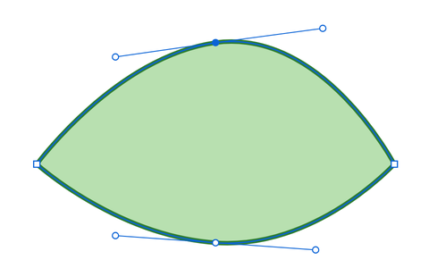

## Area fills

Fill the space that separate lines and shapes enclose, the way Illustrator's Live Paint does:
the parts of a Venn diagram, a region between curves, a wedge outlined by lines.

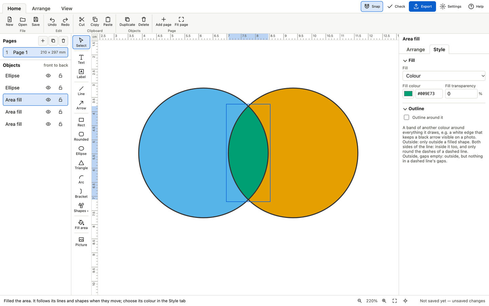

Choose **Fill area** (F) in the tools on the left and click inside an enclosed space. mosaic
adds a fill that exactly covers it, behind the lines and shapes round it, and selects it so you
can choose its colour, or a gradient, in the Style tab.

- **It follows its lines.** Move a line, drag a corner or reshape a curve, and the fill reshapes
  with it. Dragging the fill, or nudging it with the arrow keys, moves its lines and shapes with
  it.
- Lines that look joined close an area, even with a hairline gap, as long as the gap is narrower
  than about the line's width.
- A shape inside the area leaves a hole.
- **Fill reaches** (Style tab, Fill) sets where the fill stops against its lines: their middle
  (the default), their inner edge or their outer edge, as for a shape's fill. It shows in the gaps
  of dashed and dotted lines, or through see-through ones. A dashed line encloses an area just as
  a solid one does: the fill never leaks out through its gaps.
- If the lines no longer enclose the space (one is moved away or deleted), the fill disappears
  until they do again. Deleting all of its lines and shapes deletes it too.
- **Make an ordinary shape** (Arrange tab or right-click) turns it into a plain shape of the area
  as it is, which stays put when the lines move. Copied on its own, without its lines, a fill
  becomes one of these.

## Combining shapes

The **Combine** tab's **Pathfinder** buttons, as in Illustrator, make one freeform shape from the
selected shapes:

- **Unite** joins them; **Intersect** keeps only where they all overlap; **Exclude** keeps where
  they don't overlap (where an odd number of them are).
- **Minus front** cuts the shapes on top out of the bottom one.

Curves stay true curves, so the result is as smooth as the shapes were and can be resized and
restyled like any shape. It takes the top shape's style (for Minus front, the bottom one's) and
its place in the stacking order. Text in the shapes isn't kept. An area fill can be combined once
it's an ordinary shape (**Make an ordinary shape** in its Arrange tab).

## Dashes

Choose a dash in the **Line** section (round dot, short dash, dash, dash-dot, long dash…).

**Dash spacing** sets how close the dashes or dots are: their gaps as a percentage of the
style's. 100% is the style as it is, 50% twice as dense, 200% half as dense; the dashes and dots
keep their length. Like the styles themselves, it scales with the line's width. PowerPoint gets it
as a custom dash.

mosaic puts a dash (or a dot) **on every corner**, bend and line end, rounded corners
included, and spaces the dashes evenly between them. PowerPoint runs the pattern on regardless,
so dots crowd at corners and closed outlines get a squeezed spot. Untick **Even dashes** for
PowerPoint's spacing, e.g. to match an existing figure. Dashed lines from PowerPoint decks get
even dashes too.

## Connecting lines to objects

Drop either end of a line or arrow on a **connection point** to attach it. The end then follows
the object when it moves, resizes or rotates.

- **Connection points** show as small circles while you draw a line or drag its end near an
  object:
  - the object's own corners and the middles of its sides (triangle tips, star points, the
    middle of a rounded corner);
  - 8 points round an ellipse;
  - a picture's or text box's corners and side middles;
  - a line's ends and middle;
  - on dashed or dotted outlines, both ends and the middle of every dash.
- An attached end is a **green** dot. The arrow's Arrange tab lists what each end is attached to,
  with **Detach** buttons.
- Hold **⌘** while dropping an end to leave it unattached. Moving the line on its own (dragging
  it, arrow keys, align) lets go of both ends; moving it together with its objects keeps them.
- Copying a line and its objects together keeps the copies attached to each other.


**Elbow connectors:** set a line's **Route** to **Elbow** (its Arrange tab's Connections section,
or right-click → **Elbow connector**) and it runs in level and upright stretches, as in
PowerPoint and Visio:

- An end attached to an object leaves or reaches it square to that side: from a right side to a
  left side it goes across, up or down, and across again; from a side to a top or bottom, it
  turns once.
- It keeps its shape as the objects move. Drag the handle on its middle stretch to move that
  stretch along.
- **Straight** (the same list, or the menu again) makes it a straight line between its ends.

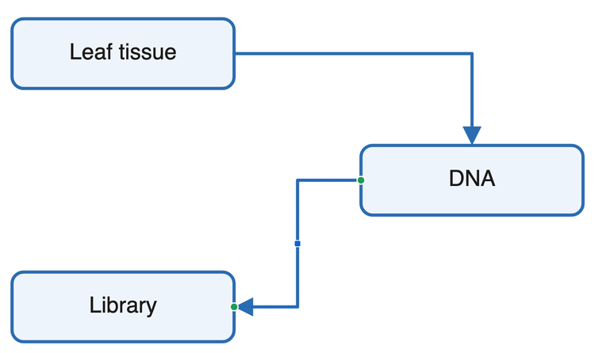

## Moving, sizing and arranging

- **Select:** click. Tab and Shift+Tab step through objects.
- **What a click picks:** a shape by what's drawn of it: inside its fill, or on its line, so a
  circle isn't picked at the corners of the box around it. A shape with no fill, or a fully clear
  one, is picked only by its line or its text; a click inside it reaches what's underneath, and a
  drag there starts a selection box. Once it's selected, you can drag it from inside, while a
  click there without dragging picks what's underneath. Text boxes, pictures and lines are picked
  anywhere they show.
- **Select several:** ⌘-click (Ctrl-click) or Shift-click another object to add it, or one
  that's selected to take it away. ⌘-drag (Ctrl-drag) an object to add it and move the whole
  selection, without snapping. Or drag on empty page: the box selects everything wholly inside
  it. Hold ⌘ or Shift to add to what's selected, and Option (Alt) to take everything the box
  touches; its edge turns solid while Option is held.
- **Select same:** right-click an object and point at **Select same** (on a Mac, also
  Edit ▸ Select Same) to select every object with the same fill colour, line colour, line
  width, fill and line, font, font size, text colour or kind of object, such as every text box,
  every rectangle, every arrow or every copy of a symbol. With several objects selected, it
  matches any of them; an object with no fill matches others with no fill. It looks at the
  page's objects, or the parts of the group you're working inside, and leaves out locked and
  hidden objects.

  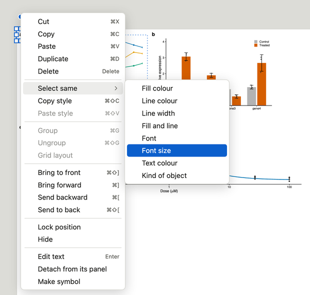
- **Move:** drag, or arrow keys: one step per press, 10 steps with Shift, a tenth of a step with
  Option (Alt). The step follows the zoom: a round amount in your units (0.01, 0.02, 0.05, 0.1…)
  that's smaller when you zoom in and bigger when you zoom out, so a press moves about the same
  distance on screen. In centimetres it's 0.05 cm at 100%, 0.01 cm at 400% and 0.2 cm at 25%.
  The status bar shows the step (**Arrows 0.05 cm**); click it for a fixed 1 pt at every zoom,
  and again to follow the zoom (also View ▸ Arrow Keys Follow the Zoom). Option-drag (Alt-drag)
  makes a copy.
- **Duplicate (⌘D)** puts the copy 10 pt down and right. Move the copy where you want it, then
  Duplicate again: the next copy goes at that same offset, as in PowerPoint. Keep pressing ⌘D
  for a row of evenly spaced copies.
- **Transform again (⌘⇧D)**, as in Illustrator, repeats your last move, resize or turn on whatever
  is selected: a drag, arrow-key nudges, or numbers typed in the Arrange tab. If the last move was
  an Option-drag (Alt-drag) copy, it makes another copy the same distance on.
- **Resize:** drag a handle. Corners keep a picture's proportions (Shift does the opposite).
  Option (Alt) resizes from the centre. Option+Shift+arrows change the size by one step.
- **Rotate:** drag the round handle above the object; Shift keeps to 15° steps.
- **Exact values:** X, Y, Width and Height at the top of the properties panel, whatever tab is
  open. They follow a drag as it happens; type a number and press Enter to set it. They're in
  centimetres (change the unit in Settings). A group's are its outline's: typing its width or
  height scales everything in it from its top-left corner, keeping its proportions (text sizes
  and line widths stay as they are). Rotation and flips are in the Arrange tab.
- **Distances:** with something selected, hold **Option** (Alt) and point at another object to see
  the gap between them (or, when one is inside the other, the four distances between their
  edges); point at empty space for the distances to the page's edges. They're in your position
  unit, and a screen reader hears them.

  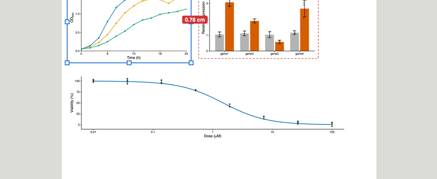
- **Group (⌘G), Ungroup (⌘⇧G)**; **Order**: bring to front (⌘⇧]), forward (⌘]), backward
  (⌘[), to back (⌘⇧[), or drag the object's row in the [Objects list](#the-objects-list).
- **Clipping mask (⌘7)**, as in Illustrator (Combine tab): put a shape on top of the objects it
  should clip, select them all and click **Make mask**. Only what's inside the shape shows, and
  the shape itself isn't drawn. They stay together as a clipping mask: double-click it to move
  things within the shape, or to change the shape (pick it by its edge). **Release** separates
  them again, the shape as it was.
- **Editing inside a group**, as in Illustrator: double-click a group (or select it and press
  Enter) to work on its parts without ungrouping it. The rest of the page fades and can't be
  picked, and a note over the page names the group. Click a part to select it on its own; move,
  resize, restyle, add or delete parts; anything you draw or paste goes into the group. Double-click
  a group inside it to go deeper. **Escape** (with nothing selected), a double-click outside the
  group or **Leave group** brings you back out, with the group selected.

  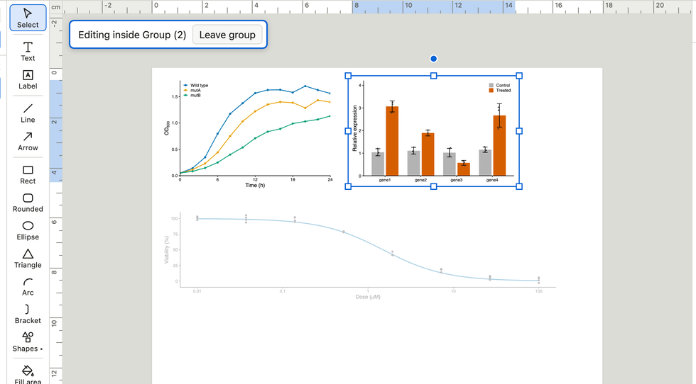
- **Lock** stops an object being selected or moved on the page; **Hide** hides it (it isn't
  exported). Both are in the Object section, the Objects list and the right-click menu.

## The Objects list

The Objects list, under Pages, shows everything on the page from front to back: the top row is in
front of everything else. A group is one row; click its triangle (or press → with the list focused)
to open it, and its parts show under it, indented.

- **Click** a row to select the object; Shift-click or ⌘-click (Ctrl-click) adds or removes one.
  Picking a part of a group works inside that group, as double-clicking it on the page does.
- **Drag a row** up or down to put the object in front of or behind others. The other rows slide
  apart where it will go, and the page already draws the objects in the new order, so you can see
  what ends up in front before you let go. **Escape** puts everything back. Several selected
  objects move together, keeping their order.
- **Into and out of groups:** drop a row between a group's parts to put it in the group there.
  Below a group's last part, move the pointer left to take the row out of the group, or right to
  keep it in; its indent shows which. Hold a row over the middle of a closed group to put it in the
  group, in front of its parts; hold it there a moment and the group opens, so you can place it
  among them. An object dragged into a group stays selected, worked on inside the group.
- **To another page:** drop rows on a page in the Pages list. The objects keep their place on the
  page and go in front of what's already there.
- A **clipping mask**'s shape stays its top part: it doesn't drag, and nothing goes in front of
  it. A **symbol** being edited takes only what symbols can hold, and a **grid layout** doesn't take
  attached panel labels, which stay with their panels.
- **From the keyboard**, with the list focused: ↑ and ↓ move through the rows, Home and End go to
  the first and last; → opens a group (and then goes to its first part), ← closes it (or goes from
  a part to its group). **Option+↑** and **Option+↓** (Alt) bring the selection forward or send it
  backward; **Option+→** moves it into the group just above it in the list, as the group's back
  part (so nothing changes on the page), and **Option+←** takes it out of its group. The last two
  are in the list's right-click menu too.

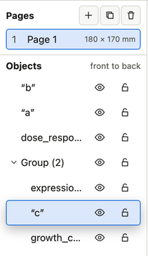

## Copying a style

Give objects the same look in one go, as with PowerPoint's Format Painter:

- **Copy style (⌘⇧C)** takes the selected object's style; **Paste style (⌘⇧V)** puts it on
  everything selected. Both are in the right-click menu too.
- **Painter** (Home tab) takes the selected object's style; then click an object to paint it on.
  Double-click Painter to paint several objects, one click each, until you press Escape. From the
  keyboard, Tab to an object and press Enter to paint it.

A style is everything the object it's pasted onto can take: the line (colour, thickness, dashes,
ends and corners), the fill (gradients included), the outline, arrowheads, corner rounding and
text formatting (font, size, bold, italic, colour, alignment and spacing). "No fill" and "no line"
are copied too, except that a line never loses its own line. A line's style gives a shape its line
and outline and leaves the shape's fill alone; a picture's style is its transparency.

## Object styles

Named looks for lines and shapes that stay linked, like [text styles](#text-and-panel-labels):
the line (colour, width, dashes, ends, corners), the fill, the outline and the arrowheads.

- **New style from this object…** (the **Object style** section at the top of a line's or
  shape's **Style** tab) names the selected object's look and links the selected objects to it.
  A line's style has no fill; a closed shape's has no arrowheads.
- **Object style** in the same section gives another object a style.
- Objects using a style follow it. To change a style, give one object the look you want and
  click **Update the style to match**: every object using the style changes too, except for what
  you've changed by hand in an object (its colour, say, or its line width), which it keeps.
- When an object differs from its style, the section says so; **Clear changes** puts it back.
- **Object styles** (Home tab) lists them, with what each looks like and how many objects use it:
  rename one, or delete it (the objects keep their look). Copy style and Paste style carry the
  link to an object style along, and colours in a style can be [swatches](#swatches).

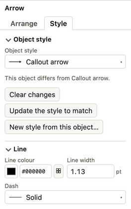

## Swatches

**Swatches** (Home tab) are named colours saved in the figure, such as one per genotype or
treatment, so every panel uses exactly the same colours.

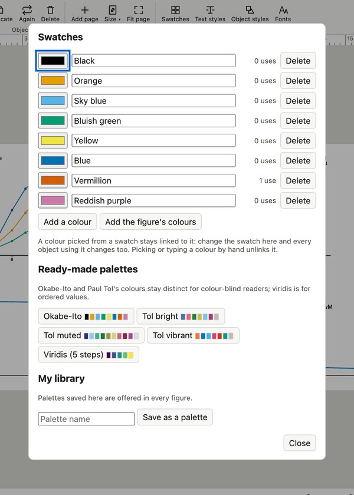

- **The swatch button** beside every colour (line, fill, gradient stops, outline, text) lists the
  figure's swatches. Pick one to use it; the panel says **Swatch:** and its name. **Add this colour
  as a swatch** saves the colour you have.
- **A colour picked from a swatch stays linked to it.** Change the swatch's colour in the Swatches
  dialog and every object using it changes too, in one step (one Undo). Picking or typing a
  colour by hand unlinks that object.
- **Ready-made palettes:** Okabe-Ito and Paul Tol's bright, muted and vibrant colours stay
  distinct for colour-blind readers; viridis steps are for ordered values. Click one to add its
  colours. Check the figure with **Colour vision** on the View tab.
- **Add the figure's colours** makes a swatch of every colour the figure uses and links the objects
  using it, so you can recolour an existing figure.
- **My library:** **Save as a palette** keeps the figure's swatches on this computer, offered in
  every figure, e.g. your lab's colours. Swatches you rename or delete in a figure don't change
  the library.
- Deleting a swatch keeps the colours; only the links go. Copy style and Paste style carry links.

## Symbols

A symbol is one object used many times and changed everywhere at once, as in Illustrator: a
cell, a tree or an instrument drawn once and placed wherever it's needed.

- **Make symbol** (Figure tab, or right-click) turns the selected objects into a symbol and
  leaves one copy where they were. A symbol can hold shapes, lines, text, brackets and groups of
  them, but not pictures (a picture placed twice already shares its file).
- **More copies:** copy and paste a copy, duplicate it (⌘D), or **Place a copy** in **Symbols…**.
  Resize a copy and its lines and text scale with it (it keeps its proportions unless you hold
  Shift); turn and flip copies like any object. The check counts a copy's lines and text at the
  size they print.
- **Edit symbol:** double-click a copy (or select it and press Enter). The symbol's objects appear
  where the copy is, at the symbol's own size, and you work on them as inside a group while the
  rest of the page fades. Press **Escape**, double-click outside or click **Leave group** when
  you're done: the symbol changes, and every copy with it, each at its own size.
- **Break link** makes a copy its own objects again, looking as it did: scaled, turned and flipped.
- **Symbols…** lists the figure's symbols, with how many copies each has: rename one, place a
  copy, or delete one that has no copies left.
- Swatches, text styles and **Fonts** reach the objects inside symbols too.

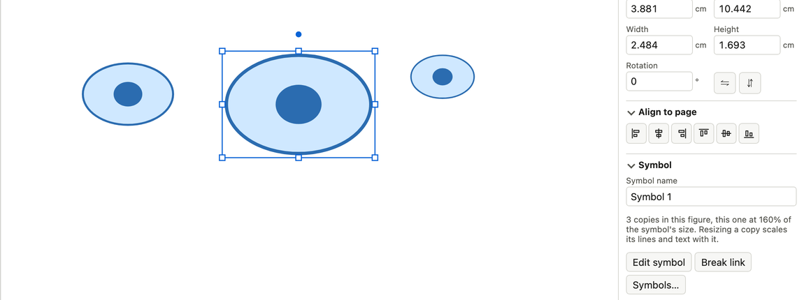

## Right-click menus

Right-click (or Control-click on a Mac) for a menu of what you can do, with each command's
shortcut beside it:

- **An object:** Cut, Copy, Paste, Duplicate, Delete; Select same, Copy style, Paste style;
  Group, Ungroup, Grid layout; the four Order commands; Lock position, Hide. A picture adds Crop, Replace and Show the
  picture's file, and Restore plot text once text has been lifted out of it in
  [dangerous mode](#dangerous-mode-editing-a-plots-own-text); a text box or shape adds Edit text,
  and a lifted text box Put back in plot; a line attached to objects adds Detach the ends; a
  group adds Edit inside the group.
  - Right-clicking an object that isn't selected selects it.
  - Right-clicking one of several selected objects keeps them all selected, so **Group** groups
    the lot.
- **Empty page:** Paste, Select all, Refresh all pictures, Insert picture, Fit page to content,
  and the Rulers, Grid, Guides and Snap switches; Leave the group while editing inside one.
- **A guide** (on the page where no object covers it, or its mark on a ruler): Remove guide,
  Remove all guides, Hide guides.
- **Paste** from a right-click puts things where you clicked. When the clipboard holds both text
  and a picture, **Paste as picture** appears beside it (see [Pictures](#pictures)).
- **A page in the Pages list:** Add, Duplicate, Delete, Move up or down, Rename.
- **An object in the Objects list:** the object's menu, with Move into the group above and Move
  out of the group. This is the way to unlock an object, since a locked one can't be clicked on
  the page.

From the keyboard, **Shift+F10** (or the menu key on a Windows keyboard) opens the menu for
whatever has the focus: the selection, the page, or the current page or object in a list. Arrow
keys move through it, a letter jumps to a command, Enter chooses, and Escape closes it. On a
line with an arrow, such as Select same, → or Enter opens its commands beside the menu, and ← or
Escape goes back.

## Align and distribute

Select objects and use the **Arrange** tab, or the panel on the right. Selecting two or more
objects shows the Arrange tab by itself (text boxes too), and it stays while you group them. Once
one object or none is selected, the tab you were on comes back, unless you picked another tab
meanwhile. Settings turns this off (**Show the Arrange tab while several objects are selected**).

- **Align**: left edges, centres, right edges, tops, middles, bottoms. With **Align to**
  **Selection**, the selection's own edges: **Top** lines them up with the highest object, **Left**
  with the leftmost, and so on. One object on its own aligns to the page.
- **Distribute**: spreads three or more objects so their left edges (centres, right edges, tops,
  middles or bottoms) are evenly spaced. The outer two stay put.
- **Spacing**: equal gaps between neighbours, **Across** or **Down**. Type a **Gap** (in your
  position unit) for exactly that gap, counted out from the key object (or the leftmost or
  topmost). Clear it for "as even as fits".
- **Align to**:
  - **Selection** (the default): lines up with the selection's edges.
  - **Page**: lines up with the page's edges; distributing moves the outer objects to the edges.
    It stays chosen until you change it.
  - **Key object**: lines up with one object that doesn't move. **Option-click** (Alt-click) one
    of the selected objects, without dragging, to make it the key. It gets a thick outline;
    Option-click it again to stop. Choosing Key object here makes the first selected the key. A
    key lasts only while the same objects are selected: select anything else and Align to goes
    back to Selection (or Page, if that was chosen).
- **Match size**: **Same width** or **Same height** makes the selected objects as wide (or as
  tall) as the key object, or with no key as the widest (or tallest), keeping their proportions
  and their top-left corners. Use it for panels of equal height in a row. Line widths and text
  sizes stay as they are.
- **Grid layout** (Arrange tab → **Grid**, or right-click): puts the selected panels in rows and
  columns, in the order they lie (rows from the top, each left to right), and keeps them there.
  - Panels keep their sizes. Each column is as wide as its widest panel and each row as tall as
    its tallest, with each panel at the top left of its cell. The gaps start as the gaps between
    the panels as they lay, or 3 mm.
  - It stays a grid: when a panel grows, shrinks or is replaced, the others move to make room.
    It moves as one, and attached panel labels go with their panels.
  - The last panel of a short last row reaches across the columns left, so a wide plot under a
    row of narrower ones doesn't widen the first column.
  - Its Arrange tab sets the **Columns** and the **Gap across** and **Gap down**. Double-click it
    to work inside it, and drag a panel onto another cell to move it there.
  - **Stop grid layout** leaves an ordinary group, with the panels where they are; **Ungroup**
    separates them. A grid can hold grids, for a row that's laid out differently.

  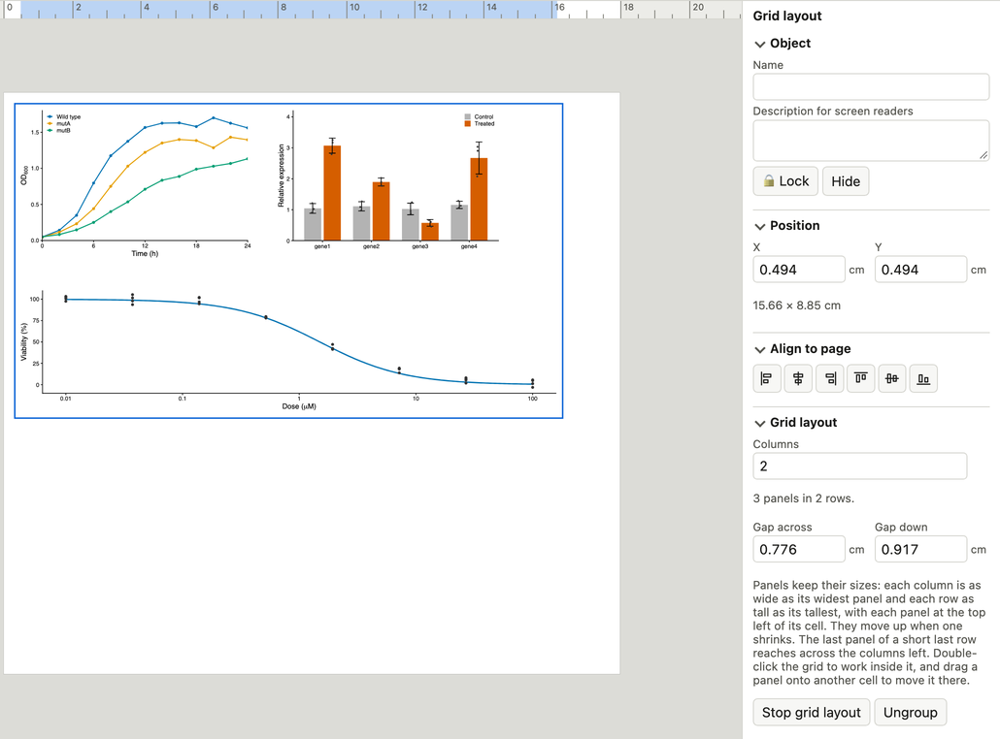

## Rulers, guides, grid and snapping


- **Rulers** (⌘R) run along the top and left, in your position unit, with 0 at the page's
  top-left corner. They mark the selection and the pointer.
- **Guides:** click a ruler to put a guide at that spot: the top ruler gives a vertical guide, the
  left one a horizontal guide. Pointing at a ruler shows where it would go first, with its
  position. A click rounds to a fine step of the ruler's ticks (1 mm at 100%, finer zoomed in), so
  clicking a tick puts the guide on it; hold **⌘** while clicking, or turn Snap off, for exactly
  where you click. Or drag one out of a ruler onto the page, where it follows the pointer.
  - Drag a guide to move it, or drag its mark on the ruler if objects cover it.
  - **Right-click** a guide (or its mark on the ruler) for **Remove guide**, **Remove all guides**
    and **Hide guides**. Dragging it back onto a ruler removes it too.
  - With nothing selected, the **Guides** section of the right panel lists them, to add one, type
    exact positions, or remove them.

  Each page has its own guides. Show or hide them with ⌘;.
- **Grid** (⌘'): graph paper over the page, 1 cm squares whose 1 mm lines appear as you zoom in.
  The spacing is in Settings (View tab → Settings).
- **Snapping:** a dragged object snaps to the page's edges and centre, to other objects' edges
  and centres, to **equal gaps** between objects (the gaps show with their size), and to guides
  and the grid while they're shown. Hidden guides and a hidden grid never pull. Grid lines give
  way to everything else. Magenta lines show what it snapped to.
- **Snapping to plots:** placed PDF and SVG plots have more to snap to: their axis lines and
  panel frames (long straight lines, not tick marks, error bars or light grid lines), and the
  edges of their ink (what's drawn, ignoring white). Only the part a crop shows counts. A plot
  being dragged snaps by its own axis lines and ink edges too, so two plots' x axes line up even
  when their tops don't. Turned pictures snap by their frame only.

  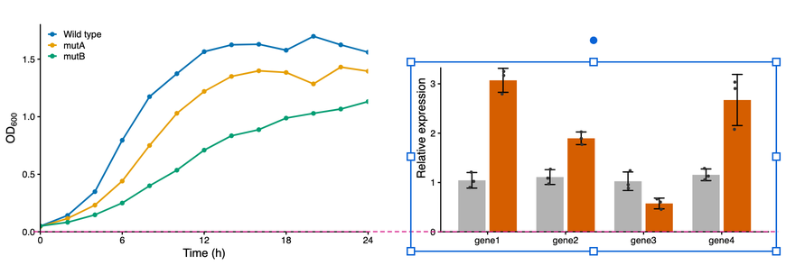

- **Getting around snapping:** hold **⌘** while dragging, just that once; turn the **Snap**
  button off (⌘⇧;); or press **Escape** mid-drag to cancel the drag. Typed values and arrow keys
  never snap.

Guides and the grid are never exported.

## Checking and exporting

**Check** (⌘⇧E) looks at the current page and lists:

- the smallest text after scaling: against the page's journal's sizes where it gives them
  (Nature 5–7 pt, PLOS Genetics 8–12 pt), else 5 pt. With a journal, text larger than it allows
  is flagged too (panel labels have a size of their own);
- text in fonts the page's journal doesn't accept (Cell takes only Arial), or a note where it
  prefers others;
- panel labels not in the page's journal's style;
- the thinnest line after scaling, including the lines inside placed PDFs and SVGs (only the
  part their crop shows), and every object with a line thinner than the page's journal allows
  (Cell 0.5 pt, Science 0.5 pt, Nature 0.25 pt), or than 0.25 pt on a page without one. Where a
  journal sets a thickest line too (Cell 1.5 pt, Nature 1 pt), thicker lines get a note. A line
  set to 0 pt, a hairline, is flagged too: it prints as thin as the printer can make it, or not
  at all. A border in a fill's own colour doesn't count, so ggplot's points drawn with
  `stroke = 0` aren't flagged;
- the page's size against a journal's figure widths and greatest depth: the page's own journal
  size, or the journal chosen at the top of the window (remembered for next time);
- pictures (PNG, TIFF, JPEG) whose resolution is too low at their printed size: on a journal
  page, the journal's resolution for the picture's kind (see **Kind** on the Picture tab:
  PNAS asks 300 dpi for photos, 600 for photos with text or lines, 1,000 for line art), or
  that it wants it as vector artwork instead (Nature and Heredity take graphs only as vector
  files, and text over photos only as editable text). Elsewhere, 300 dpi;
- pictures stretched unevenly (their frame a different shape from the file), whose text and
  curves come out distorted; **100%** on the Picture tab puts one back;
- conversions an export would need (an SVG with no PDF copy, say);
- placed files that can't be found.

Each item can select the object it's about. Fonts missing from placed PDFs (R's `pdf()` leaves
Helvetica out) are embedded automatically on export.

**Colour vision** (View tab → Check colours) shows the page as people with colour blindness see
it: **Red-green: deuteranopia** (the most common), **Red-green: protanopia**, **Blue-yellow:
tritanopia**, or **Greyscale** (as printed in black and white). Use it to check that colours that
carry meaning stay apart. Only the page and its objects change, never the exported files; a note
over the page says the preview is on, and its **Stop** button (or **Normal**) ends it. Each is
the full form, the strictest test: colours that stay apart there stay apart for the milder, more
common forms too.

**Side by side** (beside the list) shows the page all five ways at once, to compare at a glance.
Click one to keep previewing it on the page. Command search finds each view too: type "colour
blind" (or "color blind"), or a name such as "deuter".

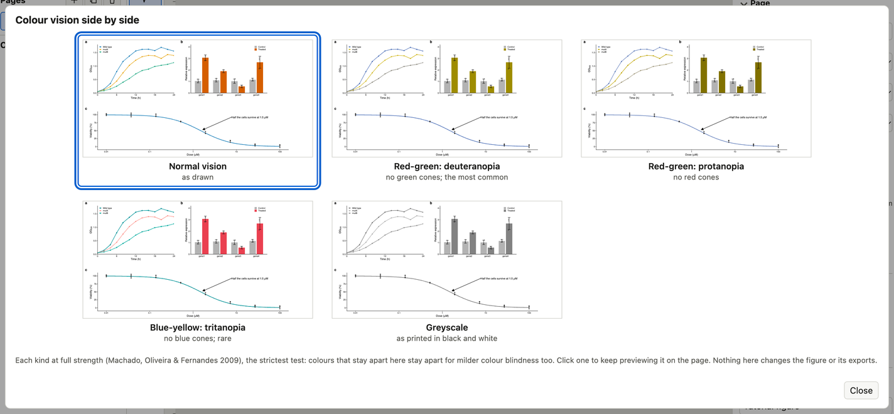

**Export** (⌘E):

- **Formats:** PDF, SVG, PNG, TIFF (LZW-compressed), PowerPoint (below). **More options:** JPEG, EPS
  (transparency is flattened), CMYK colour (TIFF, JPEG, PDF; only if a journal asks), and
  embedding missing fonts (on).
- **Resolution** for PNG, TIFF and JPEG: 300, 600 or 1200 dpi, or any other.
- **Pages:** this page or all pages. **Background:** transparent or white.
- **The page's journal:** for a page with a journal's size, the window says which files the
  journal takes, in what colour and how big, and flags the settings it doesn't take as you
  choose them: a format (PLOS Genetics takes only TIFF and EPS), too low or high a resolution
  for the page (line art needs more than photos), CMYK or RGB, fonts left unembedded, or a
  transparent background where the journal takes no transparency. Your settings stay as you
  set them. Once written, files bigger than the journal takes are flagged in the note.

Click **Export…** and choose a name and folder; one file is written per format. A PDF holds all the
chosen pages; the other formats write one file per page.
Your choices are remembered for next time.

When the files are written, the window closes and a note at the top of the page names them, with
**Show in Finder** (Show in Explorer on Windows). It goes after 10 seconds, but stays while you
point at it. If the export has warnings (a font that doesn't allow embedding, say), the note lists
them and stays until you close it (×). Fonts mosaic embedded for placed PDFs (R's `pdf()`
leaves Helvetica out) are listed as a plain line, since that's it doing its job; they don't keep
the note open. If the export fails, the window stays open and says why.

**PowerPoint** export writes an editable .pptx, each page a slide, for a collaborator who works in
PowerPoint or a talk:

- Shapes (PowerPoint's own, with their adjustments; freeforms), lines and arrows, text boxes and
  text in shapes, pictures and groups go in as PowerPoint's own objects, so they can be moved,
  restyled and edited there. A placed PDF or SVG goes in as an SVG with a PNG copy for older
  versions (as PowerPoint itself stores pictures), cropped, turned and faded as placed. Corner
  rounding is built into a freeform outline; an area fill becomes a freeform of its area.
- Anything PowerPoint can't draw exactly goes in as an exact picture of itself (an SVG with a
  PNG copy), named like the object: outlines, even dashes, the pathway and rounded arrowheads,
  scale bars, brackets, symbols' copies, clipping masks, and pictures cropped to a shape or with
  a border. The export's notes say how many went in that way, and why.
- PowerPoint has one slide size, so every page sits at the top left of a slide the size of the
  largest page.

**Figure report** (Figure tab) writes down what each picture is and how it's placed: for a methods
section, a reviewer, or whoever rebuilds the figure next. For every picture on the chosen pages
it gives:

- where it comes from (the linked file, and whether it's still there; "kept in the figure" for a
  copy stored in it; an equation's maths);
- its copies (PDF, SVG, PNG…), its size and place on the page in your position unit, and its
  scale (against its true size);
- its crop, turns and flips, and its resolution at that size (or "vector");
- its calibration (the size of a pixel, and how it was set) and its scale bars.

Choose the formats, none of them ticked to start with: **HTML** (a page to open in a browser),
**Markdown** (notes, a README), **CSV** (a spreadsheet, one row per picture) and **PDF** (to print
or attach). Then **Write report…** and choose where; each format is written next to the others
under one name. As with exporting, the window then closes and a note names the files.

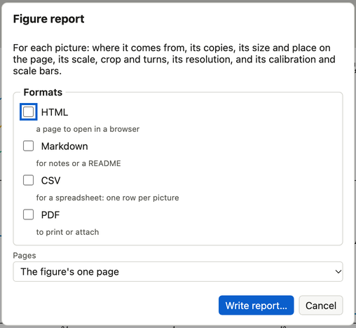

## Saving, linked files and recovery

- **Save** (⌘S) writes a `.mosaic` document. It holds your pages, the links to placed files, and
  a copy of each file, so it opens complete on another computer. **Save as** (⌘⇧S) saves a copy.
- **Open** a `.mosaic` document by double-clicking it in Finder or Explorer, or by dropping it on
  mosaic in the Dock. Or use **Open** (⌘O), which also opens slides from a PowerPoint deck
  (see [PowerPoint slides](#powerpoint-slides)).
- **Each document has a window of its own.** New (⌘N), Open and Open Recent open a new window,
  unless the window in front is blank (nothing on its pages and nothing unsaved): then they use
  it. A document that's open already comes to the front instead of opening twice. **Close** (⌘W)
  closes a window, and closing the last one quits mosaic. On Windows, each document
  double-clicked in Explorer opens in a mosaic window of its own.
- **Closing with unsaved changes** asks first, naming the figure, in a sheet on its window:
  - **Save** (Return) saves it, asking where if it was never saved, then closes it. If you
    cancel that or the save fails, the window stays open.
  - **Don't Save** (⌘D) closes it. mosaic keeps a copy of the changes and offers it back the
    next time it starts.
  - **Cancel** (Escape) leaves it open.

  Quitting (⌘Q) asks the same about each unsaved figure in turn, bringing its window to the
  front, and a Cancel stops the quit. On Windows the question's Yes saves and No doesn't.
- **Rulers, grid, guides and snapping** are switched for each window on its own. A new window
  starts with the ones you switched last. Settings apply to every window.
- **A `.mosaic` dropped on the window** adds its pages to the figure that's open: after the page
  you drop it on, or where you drop it in the Pages list. A blank page takes the first one's
  place, as for slides. The swatches, symbols and styles those pages use come with them.
- **Linked files** are checked every couple of seconds while the document is open and its window
  is showing (if it's minimised, as soon as you come back to it; if it was closed, when you open
  the document). A changed file updates its picture; a missing one falls back to the stored copy.
  A figure saved under a new name (`plot_v2.svg`) isn't followed: point the picture at it once
  with **Replace…**.
- **Refresh All Pictures** (⌘⇧R; **Refresh** in the Home tab, File ▸ Refresh All Pictures, or
  right-click the page) reads every linked picture on every page again from its files now,
  without waiting for the check. It takes an update you undid before, and copies of a plot saved
  beside its file since you placed it (a PDF or SVG that wasn't there yet), so each export can use
  its own copy. Pictures keep their place and scale, the status bar says what changed and which
  files weren't found, and ⌘Z undoes it in one step.
- **Recovery:** unsaved work is copied every minute, and as a window closes without saving. If
  mosaic closes unexpectedly, it offers the work back next time. That window can also **Delete**
  copies you don't need, one at a time or all together. **Settings → Unsaved work** shows how
  many copies are kept and can delete them. Deleting always asks first, since these are the only
  copies of work that was never saved.

## PowerPoint slides

Slides from your PowerPoint decks come into mosaic in four ways. Whichever way, their
pictures, text, lines, arrows and shapes come in as objects you can edit, and every PowerPoint
shape comes in as itself.

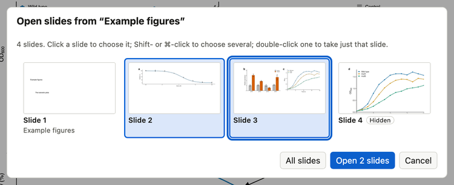

- **Open** (⌘O) a `.pptx` file to make a new document of the slides you choose. Or right-click
  the deck in Finder or Explorer and choose **Open With** → **mosaic** (PowerPoint stays the
  app a double-click opens it in). When the deck has more than one slide, the **slide picker**
  shows each one small, with its number, its title and **Hidden** for a slide hidden in the slide
  show:
  - click a slide to choose it, Shift-click to choose a run, ⌘-click to add or take away one, or
    click **All slides**, then **Open**;
  - double-click a slide to open just that one;
  - with the keyboard: the arrow keys move and choose, Shift extends, Space adds or takes away,
    Return opens.
- **Drag a deck file** from Finder or Explorer onto the window to add slides to the figure that's
  open. The same picker asks which ones.
  - Dropped on the page, the slides' objects go there, at the point you dropped them. Several
    slides' objects land a little apart. Anything parked beside a slide stays behind. On a blank
    page, see **A blank page takes the slide's size** below.
  - Dropped in the Pages list, the slides become new pages there. While you drag, a line shows
    where they'll go.
- **Copy and paste:** in PowerPoint, select slides in the slide list, or shapes on a slide, and
  copy (⌘C). Paste (⌘V) in mosaic. They come in where they were on the slide, or at the point
  you right-clicked if you chose Paste from the menu there. **Paste as picture** (right-click)
  pastes a picture of them instead.
- **Drag slides out of PowerPoint** (Mac) onto the page or into the Pages list, as with a deck
  file. PowerPoint only hands over which slides they are, so mosaic reads them from the deck
  as it was last saved, and says so. Save the deck in PowerPoint first if you've changed those
  slides. If more than one deck open in PowerPoint has slides like them, mosaic asks which
  deck you dragged from. On Windows, use copy and paste instead.
  - PowerPoint lets only its own windows accept dragged slides, so mosaic watches the drag
    itself. While the pointer is over mosaic's window, the page or the Pages list shows where
    the slides will go. When you let go, the slide flies back to PowerPoint, as it does whenever
    PowerPoint thinks a drop was refused, but the slides still come into mosaic.
    *Bringing in the slide…* shows on the page while the deck is read, which takes a few seconds
    the first time for a big deck.
  - If you press Escape to cancel a drag while it's over mosaic's window, the slides still
    come in when you let go. Undo (⌘Z) takes them out.

**A blank page takes the slide's size.** Slides added to a page with no objects on it (guides don't
count), whether pasted, dragged or picked from a dropped deck, make that page the first slide: it
takes the slide's size, and the slide's objects sit where they were on the slide. Any other slides
become new pages after it. The page keeps its name and guides. On a page that already has
objects, the slides' objects are added at the point you dropped them, and the page keeps its size.
Copied shapes, rather than whole slides, never change the page's size.

Slides or shapes added to a figure come out again with one undo, which also puts back a blank
page's size.

**Pictures** are relinked to the original figure files where they can be found, so the PDF or SVG
your R code saved is used instead of PowerPoint's copy. mosaic looks in the nearest folder
called **Figures** above the deck (where R notebooks usually save plots), or else in the deck's own
folder. For pasted shapes it looks near the deck they came from. Pasted slides don't say which deck
they came from, so on a Mac it looks near each deck PowerPoint has open. It also looks near the
figure you're working on.

Opening or dropping a deck shows a report of what came across and anything that couldn't. Pasting
shows one only when something couldn't come across.

## Settings

The gear button (⌘,):

- **Theme:** how the interface looks. Click a picture to switch at once:
  - mosaic's own Light, Dark and High contrast;
  - a dozen RStudio favourites: Textmate, Tomorrow, Solarized Light, Dawn, Xcode, Tomorrow Night,
    Solarized Dark, Monokai, Dracula, Cobalt, Material and Twilight;
  - some originals: Pistachio, Walnut, Alfalfa, Lab notebook, Blueprint, Chalkboard and Terminal.

  **Match the system** (the default) follows your computer's light and dark mode, using the
  themes you pick for **By day** and **At night**. Themes colour the interface only: the page
  stays white, so a figure looks the way it will print. Every theme keeps text readable (WCAG AA
  contrast).
- **Measurements:** the unit for positions and sizes (cm by default; mm, points or inches) and for
  page sizes (mm). Font sizes and line widths are always in points.
- **Interface:** text size, labels under toolbar buttons, showing the Home tab while text is
  selected (on unless you turn it off), reduced motion.
- **Rulers, grid and guides:** what's shown, snapping, the grid's spacing and how many finer lines
  each square has.
- **Unsaved work:** recovery copies kept from earlier sessions, with Delete all.
- **Updates:** whether new versions install by themselves, ask first or aren't looked for; test
  versions; going back a version (see [Updates](#updates)).
- **New documents:** the page size each new document starts with (A4 unless you choose another):
  paper, a slide, a poster or a journal's figure size.
- **New objects:** default text size, line width, and panel label size and case.


The version number is at the bottom. Settings are kept in a `.mosaic` folder in your home
folder, along with recovery copies, downloaded updates and a cache of rendered previews.

## Updates

mosaic updates itself. Shortly after it starts, and every few hours while it's open, it
looks on GitHub for a newer version. **Settings → Updates** chooses what happens then, and shows
the version you have, whether a newer one is ready and when it last looked:

- **Install it automatically** (the default): the new version downloads in the background, and
  the status bar says when it's ready. It installs when you quit mosaic, in about a minute (a
  few minutes when the tools mosaic uses are updated too). Click the note to see what's new,
  or **Restart now** to install it straight away: mosaic closes, installs it and opens again.
  Unsaved changes are saved first, or kept as a copy that mosaic offers back when it opens.
- **Ask me first:** the status bar says a new version is out, and nothing downloads or installs
  until you click **Update now**. **Skip this version** waits for the one after it.
- **Don't check for updates:** mosaic doesn't look. **Check for updates** (in the mosaic
  menu on a Mac, or type it in the command search, ⌘/) still looks when you ask.

More:

- **Test versions:** **Get test versions too** installs versions that are newer but less tried,
  before everyone else gets them. Switch it off to wait for the full releases.
- **Going back:** if a new version breaks something, **Go back to** (the version before) in
  Settings → Updates installs that version and opens mosaic again. Automatic updates then
  skip the version you went back from; the one after it installs as usual.
- **What's new** shows once after each update.
- **Every update is checked.** Each release is signed with mosaic's release key, and
  mosaic installs only a release whose signature matches. Anything else is refused.
- **Signing in to GitHub, for now.** While mosaic's repository is private, mosaic signs
  in to GitHub, once, to download updates. Click **Sign in for updates** in the status bar (or
  **Sign in to GitHub…** in Settings → Updates), then **Copy the code and open GitHub**. On the
  GitHub page, paste the code and click **Authorize**. mosaic can then only read
  mosaic's repository, and only because your account was added to it. The sign-in is kept in
  the Mac's Keychain or Windows' Credential Manager; **Sign out of GitHub** forgets it.
- **Documents saved by a newer version.** A document records which version of mosaic saved
  it. Opened in an older version (say, by a co-author who doesn't update), mosaic says so:
  things that version doesn't know about may not show, and saving over the document could lose
  them. Update first, or save your changes as a copy (**Save as**).
- **Several mosaic windows open** (Windows): the update installs when the last one closes.

Copies of mosaic installed before it updated itself (version 0.1.0) need one last update by
hand: download the newest release and run its installer.

## Keyboard shortcuts

Press **?** in mosaic for this list.

| Action | Mac | Windows |
|---|---|---|
| New, Open, Save, Save as | ⌘N, ⌘O, ⌘S, ⌘⇧S | Ctrl+N, Ctrl+O, Ctrl+S, Ctrl+Shift+S |
| Close the window | ⌘W | Alt+F4 |
| Export, Check before export | ⌘E, ⌘⇧E | Ctrl+E, Ctrl+Shift+E |
| Undo, Redo | ⌘Z, ⌘⇧Z | Ctrl+Z, Ctrl+Y or Ctrl+Shift+Z |
| Cut, Copy, Paste, Duplicate | ⌘X, ⌘C, ⌘V, ⌘D | Ctrl+X, Ctrl+C, Ctrl+V, Ctrl+D |
| Transform again (repeat the last move, resize or turn) | ⌘⇧D | Ctrl+Shift+D |
| Copy style, Paste style | ⌘⇧C, ⌘⇧V | Ctrl+Shift+C, Ctrl+Shift+V |
| Make clipping mask | ⌘7 | Ctrl+7 |
| Bold, Italic, Underline | ⌘B, ⌘I, ⌘U | Ctrl+B, Ctrl+I, Ctrl+U |
| Bigger text, Smaller text | ⌘⇧>, ⌘⇧< | Ctrl+Shift+>, Ctrl+Shift+< |
| Superscript, Subscript (while typing) | ⌘⇧=, ⌘= | Ctrl+Shift+=, Ctrl+= |
| Search commands | ⌘/ | Ctrl+/ |
| Delete | Delete | Delete or Backspace |
| Select all | ⌘A | Ctrl+A |
| Group, Ungroup | ⌘G, ⌘⇧G | Ctrl+G, Ctrl+Shift+G |
| Bring to front, Bring forward | ⌘⇧], ⌘] | Ctrl+Shift+], Ctrl+] |
| Send backward, Send to back | ⌘[, ⌘⇧[ | Ctrl+[, Ctrl+Shift+[ |
| In the Objects list: forward, backward | ⌥↑, ⌥↓ | Alt+↑, Alt+↓ |
| In the Objects list: into the group above, out of its group | ⌥→, ⌥← | Alt+→, Alt+← |
| In the Objects list: open or close a group | →, ← | →, ← |
| Menu for the selection | Right-click, Control-click or Shift+F10 | Right-click, Shift+F10 or the menu key |
| Zoom in, Zoom out, Fit page in window, True size | ⌘+, ⌘−, ⌘0, ⌘1 | Ctrl+Plus, Ctrl+Minus, Ctrl+0, Ctrl+1 |
| Centre page (keeping the zoom) | ⌘⇧0 | Ctrl+Shift+0 |
| Rulers, Grid, Guides | ⌘R, ⌘', ⌘; | Ctrl+R, Ctrl+', Ctrl+; |
| Refresh all pictures from their files | ⌘⇧R | Ctrl+Shift+R |
| Snap on or off | ⌘⇧; | Ctrl+Shift+; |
| Select, Text, Panel label | V, T, P | V, T, P |
| Line, Arrow, Pen | L, A, B | L, A, B |
| Rectangle, Rounded rectangle, Ellipse | R, U, O | R, U, O |
| Shapes menu | S | S |
| Fill an enclosed area | F | F |
| Insert picture | I | I |
| Add page | ⌘⇧N | Ctrl+Shift+N |
| Settings, Help | ⌘, (comma), ? | Ctrl+, (comma), ? |

In a text field, the editing keys (⌘A, ⌘C, ⌘V, ⌘Z…) work on the text, and Save, Open, New and
Export still work, saving what you've typed.

**On the page:**

- Tab / Shift+Tab: select the next or previous object.
- ⌘-click (Ctrl-click) or Shift-click: add an object to the selection, or take it away.
- Drag on empty page: select what's inside the box; with ⌘ or Shift, added to the selection; with
  Option (Alt), everything the box touches.
- Arrow keys: move by one step, which follows the zoom (the status bar shows it); Shift: 10 steps;
  Option (Alt): a tenth of a step. Option+Shift+arrows: resize by one step.
- Enter: edit text, or crop a picture. Escape: finish, deselect, or cancel a drag.
- With a drawing tool chosen, Enter places a 2 cm shape in the middle of the view.
- While dragging: Shift keeps lines straight and shapes square; Option (Alt) duplicates;
  ⌘ ignores snapping (and leaves line ends unattached).
- Space + drag, or scroll: move around, past the page's edges too, as far as keeps a little of the
  page and what's beside it in view. ⌘ + scroll, or pinch: zoom. ⌘0 fits the page in the window;
  ⌘⇧0 centres it at the zoom it has.

## Accessibility

- Every tool and setting is a labelled control you can reach with the keyboard. The toolbar, tabs,
  menus and lists move with the arrow keys; Tab moves between groups. Shift+F10 opens the
  right-click menu for whatever has the focus.
- Screen readers hear what's selected, where it is, and what each action did. Pictures can carry
  a description.
- **Settings:** interface text size, a High contrast theme (and every other theme meets WCAG AA
  contrast), labels under toolbar buttons, reduced motion. The system's dark mode, contrast and
  reduced-motion settings are followed too.

## Command line

mosaic can also run from a terminal, with its conda environment active
(`conda activate mosaic`):

```sh
mosaic                                    # open the app
mosaic figure.mosaic                      # open a document
mosaic export figure.mosaic -f pdf,svg,png --dpi 600
mosaic import-pptx deck.pptx --slides 13  # PowerPoint slides -> figure.mosaic
mosaic --browser                          # use a web browser instead of the app window
mosaic update                             # look for an update (--install installs it)
```

## Troubleshooting

**The Mac installer won't open.** macOS blocks scripts downloaded from the internet until you
allow them. After the warning, open **System Settings → Privacy & Security** and click **Open
Anyway**. Or run it in Terminal: type `bash `, drag `install-mac.command` into the window, and
press Return.

**Windows says it protected your PC.** Click **More info**, then **Run anyway**. Make sure you
extracted the ZIP first and are running the installer from the extracted folder.

**The installer stopped with a message.** It says which step failed. Most often it's the internet
connection or disk space. Fix that and run the installer again; it carries on from where it got
to. If it keeps failing, [report a problem](https://github.com/matthewwdavis/mosaic/issues/new?template=problem.yml)
and paste the last lines of the installer's window.

**An update didn't install.** The status bar says so: click it for the reason, and **Show the log**
for the installer's messages. mosaic tries again when you next quit it, and after a second
failure waits for you to click **Try again now**. You can always update by hand: download the
newest release and run its installer. If it keeps failing, [report a problem](https://github.com/matthewwdavis/mosaic/issues/new?template=problem.yml)
with the log attached.

**Updates say your GitHub account can't see mosaic's releases.** The repository is private:
ask Matthew to add your GitHub account to it. If you signed in with another account, use **Sign
out of GitHub** in Settings → Updates and sign in again.

**A picture says "Linked file not found".** The file has moved or been renamed. The picture uses
the copy stored in the document, so nothing is lost. Use **Replace…** to link it to the file's new
location.

**Text looks different from my R plot.** mosaic shows placed files exactly as they are.
If R saved Helvetica without embedding it, mosaic embeds it on export, using Arial (same
widths) if Helvetica isn't on your computer.

**Something else.** Please [report a problem](https://github.com/matthewwdavis/mosaic/issues/new?template=problem.yml),
with a screenshot if you can.

## Removing mosaic

**Mac:** drag **mosaic** from Applications to the Trash. To remove what it installed too, open
Terminal and run `~/miniforge3/bin/conda env remove -n mosaic` (use your own conda if you
had one before). If the installer installed Miniforge and you don't use conda for anything else,
delete the `miniforge3` folder in your home folder. Settings, recovery copies and downloaded
updates are in `~/.mosaic`; the GitHub sign-in is the "mosaic GitHub sign-in" item in
Keychain Access. From when mosaic was called FigAssemble, there may also be a `~/.figassemble`
folder and a "FigAssemble GitHub sign-in" item; mosaic copied what it needed from them.

**Windows:** delete the mosaic shortcuts from the desktop and Start menu. So that `.mosaic`
files and decks no longer open in mosaic, run these two lines in a Command Prompt:

```bat
for %k in (.mosaic .figasm mosaic.Document mosaic.Deck) do reg delete HKCU\Software\Classes\%k /f
for %e in (.pptx .pptm .potx) do reg delete HKCU\Software\Classes\%e\OpenWithProgids /v mosaic.Deck /f
```

Run `%USERPROFILE%\miniforge3\Scripts\conda.exe env remove -n mosaic` in a Command Prompt. If the
installer installed Miniforge, you can uninstall it under **Settings → Apps**. Settings, recovery
copies and downloaded updates are in `%USERPROFILE%\.mosaic`; the GitHub sign-in is the
"mosaic GitHub sign-in" entry in Credential Manager (Windows Credentials).
