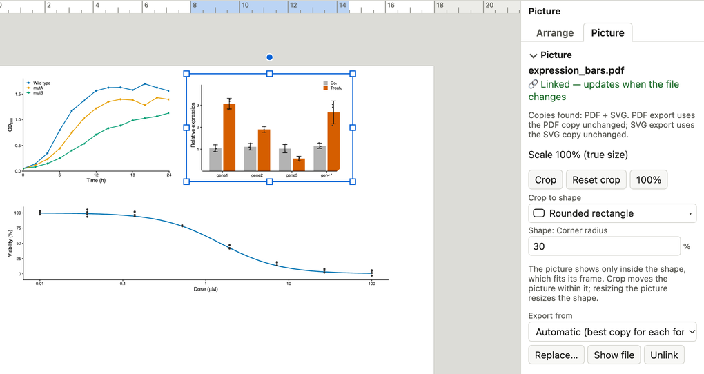
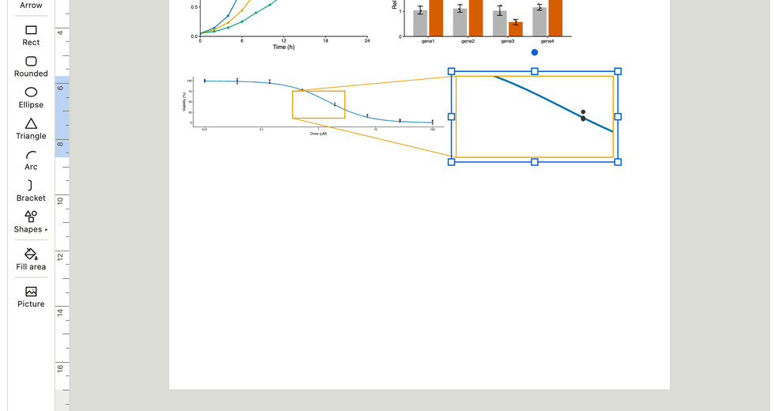
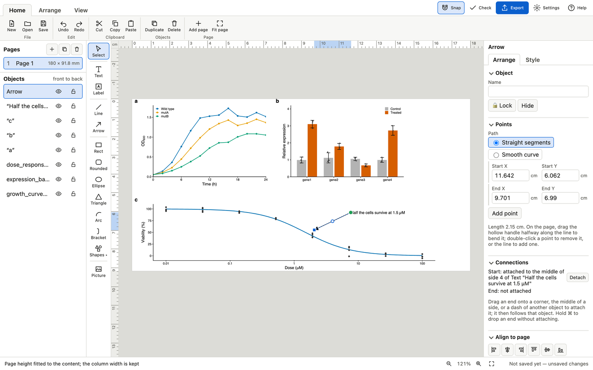
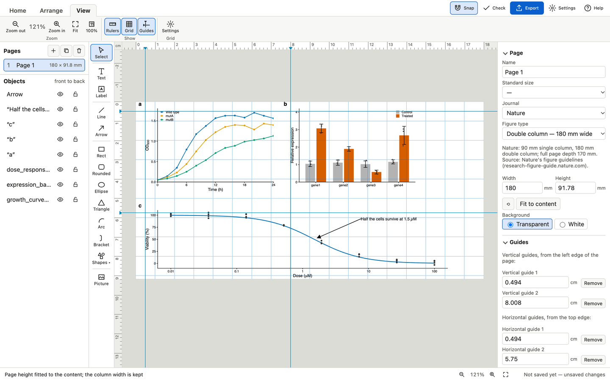
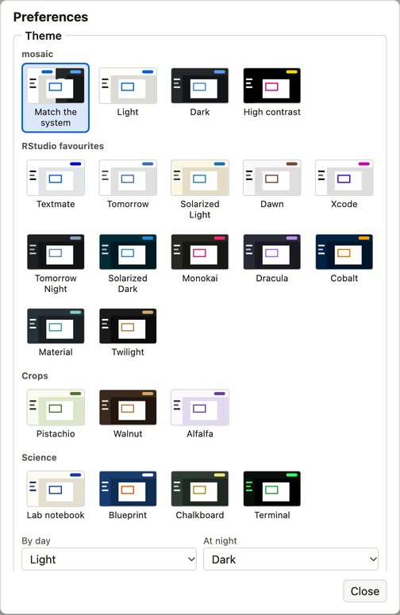

# FigAssemble user guide

Everything FigAssemble does, by topic. New to it? Start with the [tutorial](tutorial.md).
Shortcuts are written for a Mac; on Windows use **Ctrl** for **⌘** and **Shift** for **⇧**.

- [The window](#the-window)
- [Pages and page sizes](#pages-and-page-sizes)
- [Pictures](#pictures)
- [Text and panel labels](#text-and-panel-labels)
- [Lines and arrows](#lines-and-arrows)
- [Shapes](#shapes)
- [Area fills](#area-fills)
- [Dashes](#dashes)
- [Connecting lines to objects](#connecting-lines-to-objects)
- [Moving, sizing and arranging](#moving-sizing-and-arranging)
- [Right-click menus](#right-click-menus)
- [Align and distribute](#align-and-distribute)
- [Rulers, guides, grid and snapping](#rulers-guides-grid-and-snapping)
- [Checking and exporting](#checking-and-exporting)
- [Saving, linked files and recovery](#saving-linked-files-and-recovery)
- [Opening PowerPoint slides](#opening-powerpoint-slides)
- [Settings](#settings)
- [Keyboard shortcuts](#keyboard-shortcuts)
- [Accessibility](#accessibility)
- [Command line](#command-line)
- [Troubleshooting](#troubleshooting)
- [Removing FigAssemble](#removing-figassemble)

## The window


1. **Tabs** across the top, like PowerPoint's ribbon:
   - **Home**: New, Open, Save; Undo, Redo; Cut, Copy, Paste, Painter; Duplicate, Again, Delete; Add page,
     Fit page; Swatches, Text styles, Fonts.
   - **Arrange**: Align, Distribute, Spacing, Align to, Match size, Group, Order (see
     [Align and distribute](#align-and-distribute)).
   - **Figure**: scale bars (Scale bar, Measure), zoom insets and significance brackets (Bracket,
     Stack).
   - **Combine**: Pathfinder (Unite, Minus front, Intersect, Exclude) and clipping masks (Make mask,
     Release).
   - **View**: Zoom, Fit and Centre page; show or hide the Rulers, Grid and Guides; grid Settings;
     a colour vision preview (Check colours).
2. Each tab's commands, in labelled groups.
3. **Always in view:** **Snap** (on when highlighted), **Check**, **Export**, **Settings**, **Help**.
4. **Pages** of the document, and **Objects** on the current page, front to back. Each object has
   buttons to hide or lock it; click one to select it.
5. **Drawing tools**, beside the page.
6. **The page**, with rulers along the top and left.
7. **Properties** of the selection, in tabs: **Arrange** (position, size, alignment, connections),
   **Style** (shape, fill, line, arrowheads, outline), **Text**, **Picture**. With nothing
   selected, it shows the page, its guides and the document. Click a section heading to fold it;
   folded sections stay folded, and each kind of object opens on the tab you used last.
8. **Status bar:** messages, zoom, the pointer's position, and whether the document is saved.

**Panel widths:** drag the inner edge of either side panel to make it wider or narrower (or
focus the edge and use the arrow keys). Double-click the edge to put the panel back. FigAssemble
remembers the widths.

**Selection:** the box around a selected object, and its handles, stand a few pixels outside the
object, so you can see the object's own edges while you move and resize it.

The Objects list and properties panel are real form controls, usable from the keyboard and with
screen readers (see [Accessibility](#accessibility)).

## Pages and page sizes

With nothing selected (click the grey area or press Escape), the right panel shows the **Page**.

- **Standard size**: A4, US Letter or a 16:9 slide. New pages are A4.
- **Journal** and **Figure type**: sets the page to that journal's column width and its greatest
  figure depth, e.g. Nature double column, 180 × 170 mm. Built in: Cell, G3, Genetics, Genome
  Biology, Genome Research, Heredity, Molecular Biology and Evolution, Molecular Plant, Nature,
  New Phytologist, Plant Cell, PLOS Genetics, PNAS and Science. The note below says where each
  size comes from. Some journals don't publish sizes; for those the sizes were measured from a
  recent published article, and the note says so.
- **Width** and **Height**: any size. The button beside them swaps width and height.
- **Fit to content** (also **Fit page** in the Home tab): crops the page to what's on it, with
  no margin. On a journal page it keeps the column width and fits only the height.
- **Background**: transparent (the default, which journals prefer) or white.

**Pages:** the + button above the Pages list adds a page with the same size, background and
guides. The other buttons duplicate or delete the current page. Drag pages to reorder them, and
double-click a page's name to rename it. One document can hold versions of a figure side by side.

## Pictures

**Placing:** drag PDF, SVG, PNG, JPEG or TIFF files onto the page, or click **Picture** (I), or
copy the files in Finder or Explorer and paste them (⌘V). They land at **true size**, exactly as
the file says. Several files at once arrive in a cascade.

**Pasting** (⌘V, the Paste button, or right-click → Paste to paste where you clicked) takes
whatever was copied last:

- **Objects** copied in FigAssemble, in this document or another.
- **Files** copied in Finder or Explorer: placed linked, as if you'd dropped them.
- **A picture** copied in another app, such as a screenshot or an image copied from a browser,
  at true size (its recorded resolution, or 300 dpi if it has none), stored in the document. On
  a Mac, shapes and drawings copied from Illustrator, PowerPoint, Keynote or Preview arrive as a
  vector PDF, so they stay sharp. On Windows these arrive as a bitmap.
- **Text** as a text box in your default font and size (Settings → New objects), keeping bold,
  italic and line breaks.

Some apps copy text and a picture together (Word, Excel, PowerPoint). ⌘V then pastes the text;
right-click and choose **Paste as picture** for the picture instead.

- **Linked and stored:** a placed file stays **linked**, so when the file changes (you re-run your
  R code), the picture updates within a couple of seconds and keeps its place and size. A copy is
  also stored in the document, so it opens complete anywhere. Hold **Option (Alt)** while
  dropping to store a copy without the link.
- **Copies:** if a plot was saved as PDF, SVG and PNG under one name, FigAssemble finds them all.
  Each export uses the matching copy unchanged:

  | Placed as | PDF export | SVG export | PNG / TIFF export |
  |---|---|---|---|
  | PDF | the PDF page, unchanged | converted to SVG, only if there's no SVG copy | drawn once from the vectors |
  | SVG | converted to PDF, only if there's no PDF copy | the SVG, unchanged | drawn once from the vectors |
  | PNG, JPEG, TIFF | the image data, unchanged | embedded, unchanged | resampled once to the export resolution |

The **Picture** tab of a selected picture shows its file, whether the link works, the copies found,
and its **scale**. A picture that isn't at 100% says so, with a warning that its text has shrunk
or grown. Its buttons:

- **Crop**, or double-click the picture, or press Enter: drag the edges to crop, or drag the
  picture to move it inside its frame. Press Enter or Escape when done. **Reset crop** undoes it.
- **100%** puts it back to true size.
- **Crop to shape**, as in PowerPoint: the picture shows only inside a shape fitted to its frame
  (a circle, a rounded rectangle, a star…), with the shape's adjustments (a rounded rectangle's
  corner radius, say). Crop moves the picture within the shape; **None** takes it away. The
  shape clips the picture in every export, which still uses the picture's own PDF or SVG.

  
- **Border** draws a line round the picture (round its crop shape, if it has one), in any colour
  and thickness.
- **Export from** forces one copy (always the PDF, say) instead of the best copy for each format.
- **Replace…** swaps in another file, keeping the position and scale. Shift-drop a file onto a
  picture does the same.
- **Show file** reveals the linked file in Finder or Explorer.
- **Unlink** stops following the file and keeps the stored copy.

The Arrange tab has its position, size (proportions kept), rotation, flips and **Transparency**.
For screen readers, give each picture a **Description** in the Object section.

## Scale bars

A scale bar shows a real length on a photograph or micrograph, and stays right when the picture is
resized or cropped.

1. **Give the picture a scale** in its Picture tab's **Scale** section, in any of three ways:
   - **From the file:** microscope images saved by ImageJ/Fiji or as OME-TIFF carry their pixel
     size, and FigAssemble uses it when you place them (the section says "from the file").
   - **Type it:** the size of one pixel (e.g. 0.65 µm) and its unit. For a PDF or SVG, it's the
     length of one point of the original.
   - **Measure it:** click **Measure…** (or **Measure** on the Figure tab), drag along something of
     known length in the picture (a scale bar already in it, a ruler, a stage micrometer), and type
     its real length, such as `100 µm`.
2. **Add the bar:** **Add scale bar** (Picture tab), or **Scale bar** on the Figure tab with the
   picture selected. It starts a round length (1, 2 or 5 times a power of ten) about a fifth of the
   picture's width, just inside its bottom right corner: white on photographs and micrographs,
   black on plots.

The bar's own tab sets its length and unit (**Round length** picks one for you), the label above,
below or none, its colour (swatches too), thickness, text size and bold. Drag it where you want
it: it moves with its picture, keeping its place relative to the corner it's set to stay with,
and its length follows the picture's size, crop and scale.

## Zoom insets

A zoom inset shows part of a picture enlarged beside it, joined to a box on the picture by two
lines. Select the picture, click **Zoom inset** on the Figure tab, and drag a box on the picture
around the area to enlarge.



- **The inset** is a copy of the picture showing what's in the box, three times as big, to the
  picture's right (or below it when the page has no room). It's the picture's own PDF or SVG,
  so it stays sharp in every export. Drag it anywhere; resize it to enlarge more or less. Its
  height always follows the box's shape, so the picture is never stretched.
- **The box** can be dragged or resized to show another area, and the inset follows. When the
  picture moves, is resized or is cropped, the box stays over the same part of it.
- **The lines** join the corners on the outside of the box and the inset, wherever you put them.
- All three start in Okabe-Ito orange, which shows on dark images and white pages alike; change
  each one's colour and thickness as usual. A scale bar works on an inset too.

## Significance brackets

A significance bracket marks a comparison: a bar with a tick at each end and a label beyond it.
Click **Bracket** on the Figure tab and drag across the bars it compares; the bar goes at the
height you drag at, with the label above. Drag upright instead for one with its label to the right
(for a chart with horizontal bars).


- **Its tab:** the **Label** (`*`, `**`, `***`, `****`, `ns`, or **Other text…** such as a
  p-value), the side the label is on, the end ticks' length, colour (swatches too), line
  thickness, text size and bold. The ends are round and the corners square, and the bar stays put
  when the label or its size changes.
- **On the page:** drag its side handles to span other bars, and the top or bottom handle to
  lengthen the ticks.
- **Stack** (Figure tab, or the panel with several selected) tidies brackets pointing up into
  levels: the narrowest lowest, brackets that don't overlap side by side on one level, and each
  level just above the one below. Their ends stay where they are.

## Text and panel labels

- **Text (T):** click to type, or drag to make a box the text wraps in. Press **Escape** when
  done. Double-click any text, or select it and press Enter, to edit it again. In the editor, ⌘B,
  ⌘I and ⌘U make the selected words bold, italic or underlined, and ⌘⇧= and ⌘= superscript or
  subscript (as in PowerPoint); Shift+Return starts a new line.
- **Superscript and subscript** (x² and x₂ on the Text tab) work on the selected words while you
  type, or on the whole box otherwise.
- **Symbols** (Text tab): µ, °, ±, ×, arrows, ⇌, ‰, primes, Å and the Greek letters, put in where
  the cursor is while you type, or at the end of the selected text box otherwise.
- The **Text** tab sets the font, size (in points), colour, bold, italic and underline for the
  whole box, and alignment, vertical position, wrapping and **Resize the box to fit the text**.
- **Panel label (P):** click to add the next free letter (a, b, c…) in bold 8 pt Helvetica.
  Settings changes the size and case.
- Any shape can hold text: double-click it to type.
- **Text styles** keep text alike: **New style from this text…** on the Text tab names the selected
  text's format (font, size, colour, bold, italic, underline, alignment, spacing), and **Text
  style** gives a style to other text. Text using a style follows it:
  - To change a style, format one text the way you want and click **Update the style to match**.
    Every text using the style changes, but anything you changed by hand in a text (say, one label
    made bigger) stays. The Text tab says when a text differs from its style; **Clear changes**
    puts it back.
  - A style named **Panel label** is used for new panel labels.
  - **Text styles** (Home tab) renames and deletes styles, with what each looks like and how much
    text uses it. Deleting a style keeps the text's format.
- **Fonts** (Home tab, or **Fonts…** in Check) lists every font the figure's text uses, how many
  text objects use each, and whether it's on this computer (one that isn't is drawn with a
  stand-in). Type another font beside one and click **Replace** to swap it on every page, e.g.
  Arial from old slides for Helvetica. Text inside placed pictures keeps its own fonts.

Helvetica is used if you have it, Arial otherwise (it has the same letter widths). Text stays
real text in PDF and SVG exports, with the fonts embedded.

## Lines and arrows

- **Line (L)** and **Arrow (A):** drag from start to end, or click for a 2 cm line. Hold **Shift**
  to keep to multiples of 45°.
- **Curves:** select a line and drag the hollow handle halfway along it: it bends into a smooth
  curve through that point, and an arrowhead follows the curve. Drag other hollow handles to add
  more points (S-curves). Drag points to reshape it; double-click a point to remove it, or the
  line to add one. The **Points** section lists every point's position and switches between
  **Smooth curve** and **Straight segments**.
- **Style** tab: colour, width (in points), [dash](#dashes), line ends (round, flat or square),
  corners, transparency.
- **Arrowheads:** each end can be none, triangle, stealth, open arrow, circle or diamond, small
  to large. **Rounding** (0-100%) rounds a pointed head's tip, which still ends exactly on the
  line's end. **Swap ends** swaps them.
- **Pathway ends:** **Bar** (inhibition, ⊣), **Half arrow** (one barb, on the left of the way the
  line goes, so two lines in opposite directions make ⇌), **Open circle** and **Open triangle**
  (catalysis and stimulation in SBGN). The line stops at an open circle's or triangle's edge, so
  it doesn't show inside.
- **Outline** ([see Shapes](#shapes)) draws a band of another colour around the line and its head.

## Shapes

- **Tools beside the page:** Rectangle (R), Rounded rectangle (U), Ellipse (O), Triangle, Arc,
  Bracket. Drag to draw (Shift for squares and circles), or click for a 2 cm shape. With the
  keyboard: choose a tool and press Enter to place one in the middle of the view.
- **Shapes menu (S):** PowerPoint's shapes in groups: rectangles, basic shapes, block arrows,
  stars, brackets and braces, equation symbols. Arrow keys move through it, typing a name jumps
  to it, Enter chooses.

  

- **Yellow handles** adjust a shape the way PowerPoint's do (a rounded rectangle's corners, a
  star's inner radius, a block arrow's head). The **Shape** section of the Style tab names each
  adjustment so you can type it, and can change one shape into another.
- **Corner rounding** (0-100%) rounds every straight-edged shape's corners (triangles, polygons,
  stars, arrows). 100% is as round as the shape allows; a triangle becomes a circle.
- **Fill**: none, a colour with transparency, or a gradient. Every colour has a picker and a hex
  code (`#1A2B3C`) you can type or paste.
  - **Linear gradient**: a blend at any angle (90° runs top to bottom).
  - **Radial gradient**: circles from the middle or a corner, out to the far corner.

  A gradient has two or more **colour stops**, each with a position along it and its own
  transparency. **Add stop** puts one in the widest gap; **Reverse** swaps the ends. Gradients
  from PowerPoint slides come in as they were.
- **Outline around it**: a band in a second colour around everything the object draws, e.g. a white
  edge that keeps a black arrow visible on a photo. You set its thickness and transparency, and
  where it goes with two lists, each showing only the choices that look different on the
  selected object:
  - **Sides**: **Outside** (only outside the shape), **Inside** (only inside it, over any fill)
    or **Both sides** (along both sides of the line). A shape whose line goes all the way round
    it has all three, filled or not. A fill with no line has Outside and Inside (a band just
    inside its edge). A line, or an open shape such as an arc or a bracket, has no inside, so it
    has no Sides list.
  - **Gaps** (dashed or dotted lines only): **Filled**, the band runs on through the gaps
    between dashes, or **Empty**, it goes only round each dash or dot.
- **Make editable curve** (arcs): turns an arc into a curve with points you can drag.

## Area fills

Fill the space that separate lines and shapes enclose, the way Illustrator's Live Paint does:
the parts of a Venn diagram, a region between curves, a wedge outlined by lines.


Choose **Fill area** (F) in the tools on the left and click inside an enclosed space. FigAssemble
adds a fill that exactly covers it, behind the lines and shapes round it, and selects it so you
can choose its colour, or a gradient, in the Style tab.

- **It follows its lines.** Move a line, drag a corner or reshape a curve, and the fill reshapes
  with it. Dragging the fill, or nudging it with the arrow keys, moves its lines and shapes with
  it.
- Lines that look joined close an area, even with a hairline gap, as long as the gap is narrower
  than about the line's width.
- A shape inside the area leaves a hole.
- If the lines no longer enclose the space (one is moved away or deleted), the fill disappears
  until they do again. Deleting all of its lines and shapes deletes it too.
- **Make an ordinary shape** (Arrange tab or right-click) turns it into a plain shape of the area
  as it is, which stays put when the lines move. Copied on its own, without its lines, a fill
  becomes one of these.

## Combining shapes

The **Combine** tab's **Pathfinder** buttons, as in Illustrator, make one freeform shape from the
selected shapes:

- **Unite** joins them; **Intersect** keeps only where they all overlap; **Exclude** keeps where
  they don't overlap (where an odd number of them are).
- **Minus front** cuts the shapes on top out of the bottom one.

Curves stay true curves, so the result is as smooth as the shapes were and can be resized and
restyled like any shape. It takes the top shape's style (for Minus front, the bottom one's) and
its place in the stacking order. Text in the shapes isn't kept. An area fill can be combined once
it's an ordinary shape (**Make an ordinary shape** in its Arrange tab).

## Dashes

Choose a dash in the **Line** section (round dot, short dash, dash, dash-dot, long dash…).

FigAssemble puts a dash (or a dot) **on every corner**, bend and line end, rounded corners
included, and spaces the dashes evenly between them. PowerPoint runs the pattern on regardless,
so dots crowd at corners and closed outlines get a squeezed spot. Untick **Even dashes** for
PowerPoint's spacing, e.g. to match an existing figure. Dashed lines from PowerPoint decks get
even dashes too.

## Connecting lines to objects

Drop either end of a line or arrow on a **connection point** to attach it. The end then follows
the object when it moves, resizes or rotates.

- **Connection points** show as small circles while you draw a line or drag its end near an
  object:
  - the object's own corners and the middles of its sides (triangle tips, star points, the
    middle of a rounded corner);
  - 8 points round an ellipse;
  - a picture's or text box's corners and side middles;
  - a line's ends and middle;
  - on dashed or dotted outlines, both ends and the middle of every dash.
- An attached end is a **green** dot. The arrow's Arrange tab lists what each end is attached to,
  with **Detach** buttons.
- Hold **⌘** while dropping an end to leave it unattached. Moving the line on its own (dragging
  it, arrow keys, align) lets go of both ends; moving it together with its objects keeps them.
- Copying a line and its objects together keeps the copies attached to each other.



## Moving, sizing and arranging

- **Select:** click; Shift-click adds or removes; drag on empty space to select everything
  inside a box. Tab and Shift+Tab step through objects.
- **Move:** drag, or arrow keys: 1 pt per press, 10 pt with Shift, 0.1 pt with Option (Alt).
  Option-drag (Alt-drag) makes a copy.
- **Duplicate (⌘D)** puts the copy 10 pt down and right. Move the copy where you want it, then
  Duplicate again: the next copy goes at that same offset, as in PowerPoint. Keep pressing ⌘D
  for a row of evenly spaced copies.
- **Transform again (⌘⇧D)**, as in Illustrator, repeats your last move, resize or turn on whatever
  is selected: a drag, arrow-key nudges, or numbers typed in the Arrange tab. If the last move was
  an Option-drag (Alt-drag) copy, it makes another copy the same distance on.
- **Resize:** drag a handle. Corners keep a picture's proportions (Shift does the opposite).
  Option (Alt) resizes from the centre. Option+Shift+arrows change the size by 1 pt.
- **Rotate:** drag the round handle above the object; Shift keeps to 15° steps.
- **Exact values:** the Arrange tab's X, Y, Width, Height and Rotation, in centimetres (change
  the unit in Settings), plus flips.
- **Group (⌘G), Ungroup (⌘⇧G)**; **Order**: bring to front (⌘⇧]), forward (⌘]), backward
  (⌘[), to back (⌘⇧[).
- **Clipping mask (⌘7)**, as in Illustrator (Combine tab): put a shape on top of the objects it
  should clip, select them all and click **Make mask**. Only what's inside the shape shows, and
  the shape itself isn't drawn. They stay together as a clipping mask: double-click it to move
  things within the shape, or to change the shape (pick it by its edge). **Release** separates
  them again, the shape as it was.
- **Editing inside a group**, as in Illustrator: double-click a group (or select it and press
  Enter) to work on its parts without ungrouping it. The rest of the page fades and can't be
  picked, and a note over the page names the group. Click a part to select it on its own; move,
  resize, restyle, add or delete parts; anything you draw or paste goes into the group. Double-click
  a group inside it to go deeper. **Escape** (with nothing selected), a double-click outside the
  group or **Leave group** brings you back out, with the group selected.

  
- **Lock** stops an object being selected or moved on the page; **Hide** hides it (it isn't
  exported). Both are in the Object section, the Objects list and the right-click menu.

## Copying a style

Give objects the same look in one go, as with PowerPoint's Format Painter:

- **Copy style (⌘⇧C)** takes the selected object's style; **Paste style (⌘⇧V)** puts it on
  everything selected. Both are in the right-click menu too.
- **Painter** (Home tab) takes the selected object's style; then click an object to paint it on.
  Double-click Painter to paint several objects, one click each, until you press Escape. From the
  keyboard, Tab to an object and press Enter to paint it.

A style is everything the object it's pasted onto can take: the line (colour, thickness, dashes,
ends and corners), the fill (gradients included), the outline, arrowheads, corner rounding and
text formatting (font, size, bold, italic, colour, alignment and spacing). "No fill" and "no line"
are copied too, except that a line never loses its own line. A line's style gives a shape its line
and outline and leaves the shape's fill alone; a picture's style is its transparency.

## Swatches

**Swatches** (Home tab) are named colours saved in the figure, such as one per genotype or
treatment, so every panel uses exactly the same colours.


- **The swatch button** beside every colour (line, fill, gradient stops, outline, text) lists the
  figure's swatches. Pick one to use it; the panel says **Swatch:** and its name. **Add this colour
  as a swatch** saves the colour you have.
- **A colour picked from a swatch stays linked to it.** Change the swatch's colour in the Swatches
  dialog and every object using it changes too, in one step (one Undo). Picking or typing a
  colour by hand unlinks that object.
- **Ready-made palettes:** Okabe-Ito and Paul Tol's bright, muted and vibrant colours stay
  distinct for colour-blind readers; viridis steps are for ordered values. Click one to add its
  colours. Check the figure with **Colour vision** on the View tab.
- **Add the figure's colours** makes a swatch of every colour the figure uses and links the objects
  using it, so you can recolour an existing figure.
- **My library:** **Save as a palette** keeps the figure's swatches on this computer, offered in
  every figure, e.g. your lab's colours. Swatches you rename or delete in a figure don't change
  the library.
- Deleting a swatch keeps the colours; only the links go. Copy style and Paste style carry links.

## Right-click menus

Right-click (or Control-click on a Mac) for a menu of what you can do, with each command's
shortcut beside it:

- **An object:** Cut, Copy, Paste, Duplicate, Delete; Copy style, Paste style; Group, Ungroup;
  the four Order commands; Lock position, Hide. A picture adds Crop, Replace and Show the
  picture's file; a text box or shape adds Edit text; a line attached to objects adds Detach
  the ends; a group adds Edit inside the group.
  - Right-clicking an object that isn't selected selects it.
  - Right-clicking one of several selected objects keeps them all selected, so **Group** groups
    the lot.
- **Empty page:** Paste, Select all, Insert picture, Fit page to content, and the Rulers, Grid,
  Guides and Snap switches; Leave the group while editing inside one.
- **Paste** from a right-click puts things where you clicked. When the clipboard holds both text
  and a picture, **Paste as picture** appears beside it (see [Pictures](#pictures)).
- **A page in the Pages list:** Add, Duplicate, Delete, Move up or down, Rename.
- **An object in the Objects list:** the object's menu. This is the way to unlock an object,
  since a locked one can't be clicked on the page.

From the keyboard, **Shift+F10** (or the menu key on a Windows keyboard) opens the menu for
whatever has the focus: the selection, the page, or the current page or object in a list. Arrow
keys move through it, a letter jumps to a command, Enter chooses, and Escape closes it.

## Align and distribute

Select objects and use the **Arrange** tab, or the panel on the right:

- **Align**: left edges, centres, right edges, tops, middles, bottoms. One object on its own
  aligns to the page.
- **Distribute**: spreads three or more objects so their left edges (centres, right edges, tops,
  middles or bottoms) are evenly spaced. The outer two stay put.
- **Spacing**: equal gaps between neighbours, **Across** or **Down**. Type a **Gap** (in your
  position unit) for exactly that gap, counted out from the key object. Clear it for "as even as
  fits".
- **Align to**:
  - **Selection** (the default): lines up with the selection's edges.
  - **Page**: lines up with the page's edges; distributing moves the outer objects to the edges.
  - **Key object**: lines up with one object that doesn't move. Click one of the selected
    objects (without dragging) to make it the key. It gets a thick outline; click it again to stop.
- **Match size**: **Same width** or **Same height** makes the selected objects as wide (or as
  tall) as the key object, or the first one selected, keeping their proportions and their
  top-left corners. Use it for panels of equal height in a row. Line widths and text sizes stay
  as they are.

## Rulers, guides, grid and snapping



- **Rulers** (⌘R) run along the top and left, in your position unit, with 0 at the page's
  top-left corner. They mark the selection and the pointer.
- **Guides:** drag one out of a ruler onto the page. Drag a guide to move it, or drag its mark on
  the ruler if objects cover it. Drag it back onto a ruler to remove it. With nothing selected,
  the **Guides** section of the right panel lists them, to add one, type exact positions, or
  remove them. Each page has its own guides. Show or hide them with ⌘;.
- **Grid** (⌘'): graph paper over the page, 1 cm squares whose 1 mm lines appear as you zoom in.
  The spacing is in Settings (View tab → Settings).
- **Snapping:** a dragged object snaps to the page's edges and centre, to other objects' edges
  and centres, to **equal gaps** between objects (the gaps show with their size), and to guides
  and the grid while they're shown. Hidden guides and a hidden grid never pull. Grid lines give
  way to everything else. Magenta lines show what it snapped to.
- **Getting around snapping:** hold **⌘** while dragging, just that once; turn the **Snap**
  button off (⌘⇧;); or press **Escape** mid-drag to cancel the drag. Typed values and arrow keys
  never snap.

Guides and the grid are never exported.

## Checking and exporting

**Check** (⌘⇧E) looks at the current page and lists:

- the smallest text after scaling (journals often ask for at least 5 pt);
- images whose resolution is too low at their printed size;
- conversions an export would need (an SVG with no PDF copy, say);
- placed files that can't be found.

Each item can select the object it's about. Fonts missing from placed PDFs (R's `pdf()` leaves
Helvetica out) are embedded automatically on export.

**Colour vision** (View tab → Check colours) shows the page as people with colour blindness see
it: **Red-green: deuteranopia** (the most common), **Red-green: protanopia**, **Blue-yellow:
tritanopia**, or **Greyscale** (as printed in black and white). Use it to check that colours that
carry meaning stay apart. Only the page and its objects change, never the exported files; a note
over the page says the preview is on, and its **Stop** button (or **Normal**) ends it.

**Export** (⌘E):

- **Formats:** PDF, SVG, PNG, TIFF (LZW-compressed). **More options:** JPEG, EPS (transparency is
  flattened), CMYK colour (TIFF, JPEG, PDF; only if a journal asks), and embedding missing fonts
  (on).
- **Resolution** for PNG, TIFF and JPEG: 300, 600 or 1200 dpi, or any other.
- **Pages:** this page or all pages. **Background:** transparent or white.

Click **Export…** and choose a name and folder; one file is written per format. A PDF holds all the
chosen pages; the other formats write one file per page.
Your choices are remembered for next time.

## Saving, linked files and recovery

- **Save** (⌘S) writes a `.figasm` document. It holds your pages, the links to placed files, and
  a copy of each file, so it opens complete on another computer. **Save as** (⌘⇧S) saves a copy.
- **Open** (⌘O) opens a `.figasm` document, or a PowerPoint deck (see below).
- **Linked files** are checked every couple of seconds while the document is open. A changed file
  updates its picture; a missing one falls back to the stored copy.
- **Recovery:** unsaved work is copied every minute. If FigAssemble closes unexpectedly, it offers
  the work back next time. That window can also **Delete** copies you don't need, one at a time or
  all together. **Settings → Unsaved work** shows how many copies are kept and can delete them.
  Deleting always asks first, since these are the only copies of work that was never saved.

## Opening PowerPoint slides

**Open** a `.pptx` file to turn its slides into pages. Pictures, text, lines, arrows and shapes come
in where they were, and every PowerPoint shape comes in as itself. Pictures are relinked to the
original figure files where they can be found, so the PDF or SVG your R code saved is used
instead of PowerPoint's copy. FigAssemble looks in the nearest folder called **Figures** above the
deck (where R notebooks usually save plots), or else in the deck's own folder. A report lists
anything that couldn't be brought across.

## Settings

The gear button (⌘,):

- **Theme:** how the interface looks. Click a picture to switch at once:
  - FigAssemble's own Light, Dark and High contrast;
  - a dozen RStudio favourites: Textmate, Tomorrow, Solarized Light, Dawn, Xcode, Tomorrow Night,
    Solarized Dark, Monokai, Dracula, Cobalt, Material and Twilight;
  - some originals: Pistachio, Walnut, Alfalfa, Lab notebook, Blueprint, Chalkboard and Terminal.

  **Match the system** (the default) follows your computer's light and dark mode, using the
  themes you pick for **By day** and **At night**. Themes colour the interface only: the page
  stays white, so a figure looks the way it will print. Every theme keeps text readable (WCAG AA
  contrast).
- **Measurements:** the unit for positions and sizes (cm by default; mm, points or inches) and for
  page sizes (mm). Font sizes and line widths are always in points.
- **Interface:** text size, labels under toolbar buttons, reduced motion.
- **Rulers, grid and guides:** what's shown, snapping, the grid's spacing and how many finer lines
  each square has.
- **Unsaved work:** recovery copies kept from earlier sessions, with Delete all.
- **New objects:** default text size, line width, and panel label size and case.



The version number is at the bottom. Settings are kept in a `.figassemble` folder in your home
folder, along with recovery copies and a cache of rendered previews.

## Keyboard shortcuts

Press **?** in FigAssemble for this list.

| Action | Mac | Windows |
|---|---|---|
| New, Open, Save, Save as | ⌘N, ⌘O, ⌘S, ⌘⇧S | Ctrl+N, Ctrl+O, Ctrl+S, Ctrl+Shift+S |
| Export, Check before export | ⌘E, ⌘⇧E | Ctrl+E, Ctrl+Shift+E |
| Undo, Redo | ⌘Z, ⌘⇧Z | Ctrl+Z, Ctrl+Y or Ctrl+Shift+Z |
| Cut, Copy, Paste, Duplicate | ⌘X, ⌘C, ⌘V, ⌘D | Ctrl+X, Ctrl+C, Ctrl+V, Ctrl+D |
| Transform again (repeat the last move, resize or turn) | ⌘⇧D | Ctrl+Shift+D |
| Copy style, Paste style | ⌘⇧C, ⌘⇧V | Ctrl+Shift+C, Ctrl+Shift+V |
| Make clipping mask | ⌘7 | Ctrl+7 |
| Superscript, Subscript (while typing) | ⌘⇧=, ⌘= | Ctrl+Shift+=, Ctrl+= |
| Delete | Delete | Delete or Backspace |
| Select all | ⌘A | Ctrl+A |
| Group, Ungroup | ⌘G, ⌘⇧G | Ctrl+G, Ctrl+Shift+G |
| Bring to front, Bring forward | ⌘⇧], ⌘] | Ctrl+Shift+], Ctrl+] |
| Send backward, Send to back | ⌘[, ⌘⇧[ | Ctrl+[, Ctrl+Shift+[ |
| Menu for the selection | Right-click, Control-click or Shift+F10 | Right-click, Shift+F10 or the menu key |
| Zoom in, Zoom out, Fit page in window, True size | ⌘+, ⌘−, ⌘0, ⌘1 | Ctrl+Plus, Ctrl+Minus, Ctrl+0, Ctrl+1 |
| Centre page (keeping the zoom) | ⌘⇧0 | Ctrl+Shift+0 |
| Rulers, Grid, Guides | ⌘R, ⌘', ⌘; | Ctrl+R, Ctrl+', Ctrl+; |
| Snap on or off | ⌘⇧; | Ctrl+Shift+; |
| Select, Text, Panel label | V, T, P | V, T, P |
| Line, Arrow | L, A | L, A |
| Rectangle, Rounded rectangle, Ellipse | R, U, O | R, U, O |
| Shapes menu | S | S |
| Fill an enclosed area | F | F |
| Insert picture | I | I |
| Add page | ⌘⇧N | Ctrl+Shift+N |
| Settings, Help | ⌘, (comma), ? | Ctrl+, (comma), ? |

In a text field, the editing keys (⌘A, ⌘C, ⌘V, ⌘Z…) work on the text, and Save, Open, New and
Export still work, saving what you've typed.

**On the page:**

- Tab / Shift+Tab: select the next or previous object.
- Arrow keys: move by 1 pt; Shift: 10 pt; Option (Alt): 0.1 pt. Option+Shift+arrows: resize by 1 pt.
- Enter: edit text, or crop a picture. Escape: finish, deselect, or cancel a drag.
- With a drawing tool chosen, Enter places a 2 cm shape in the middle of the view.
- While dragging: Shift keeps lines straight and shapes square; Option (Alt) duplicates;
  ⌘ ignores snapping (and leaves line ends unattached).
- Space + drag, or scroll: move around. ⌘ + scroll, or pinch: zoom. While the whole page fits in
  the view, it stays centred; zoomed in further, ⌘⇧0 brings it back to the middle.

## Accessibility

- Every tool and setting is a labelled control you can reach with the keyboard. The toolbar, tabs,
  menus and lists move with the arrow keys; Tab moves between groups. Shift+F10 opens the
  right-click menu for whatever has the focus.
- Screen readers hear what's selected, where it is, and what each action did. Pictures can carry
  a description.
- **Settings:** interface text size, a High contrast theme (and every other theme meets WCAG AA
  contrast), labels under toolbar buttons, reduced motion. The system's dark mode, contrast and
  reduced-motion settings are followed too.

## Command line

FigAssemble can also run from a terminal, with its conda environment active
(`conda activate figassemble`):

```sh
figassemble                                    # open the app
figassemble figure.figasm                      # open a document
figassemble export figure.figasm -f pdf,svg,png --dpi 600
figassemble import-pptx deck.pptx --slides 13  # PowerPoint slides -> figure.figasm
figassemble --browser                          # use a web browser instead of the app window
```

## Troubleshooting

**The Mac installer won't open.** macOS blocks scripts downloaded from the internet until you
allow them. After the warning, open **System Settings → Privacy & Security** and click **Open
Anyway**. Or run it in Terminal: type `bash `, drag `install-mac.command` into the window, and
press Return.

**Windows says it protected your PC.** Click **More info**, then **Run anyway**. Make sure you
extracted the ZIP first and are running the installer from the extracted folder.

**The installer stopped with a message.** It says which step failed. Most often it's the internet
connection or disk space. Fix that and run the installer again; it carries on from where it got
to. If it keeps failing, [report a problem](https://github.com/matthewwdavis/FigAssemble/issues/new?template=problem.yml)
and paste the last lines of the installer's window.

**A picture says "Linked file not found".** The file has moved or been renamed. The picture uses
the copy stored in the document, so nothing is lost. Use **Replace…** to link it to the file's new
location.

**Text looks different from my R plot.** FigAssemble shows placed files exactly as they are.
If R saved Helvetica without embedding it, FigAssemble embeds it on export, using Arial (same
widths) if Helvetica isn't on your computer.

**Something else.** Please [report a problem](https://github.com/matthewwdavis/FigAssemble/issues/new?template=problem.yml),
with a screenshot if you can.

## Removing FigAssemble

**Mac:** drag **FigAssemble** from Applications to the Trash. To remove what it installed too, open
Terminal and run `~/miniforge3/bin/conda env remove -n figassemble` (use your own conda if you
had one before). If the installer installed Miniforge and you don't use conda for anything else,
delete the `miniforge3` folder in your home folder. Settings and recovery copies are in
`~/.figassemble`.

**Windows:** delete the FigAssemble shortcuts from the desktop and Start menu. Run
`%USERPROFILE%\miniforge3\Scripts\conda.exe env remove -n figassemble` in a Command Prompt. If the
installer installed Miniforge, you can uninstall it under **Settings → Apps**. Settings and
recovery copies are in `%USERPROFILE%\.figassemble`.
