# Tutorial: your first figure

In about 15 minutes you'll build this three-panel figure for a Nature double-column page, and
meet most of what FigAssemble does along the way:

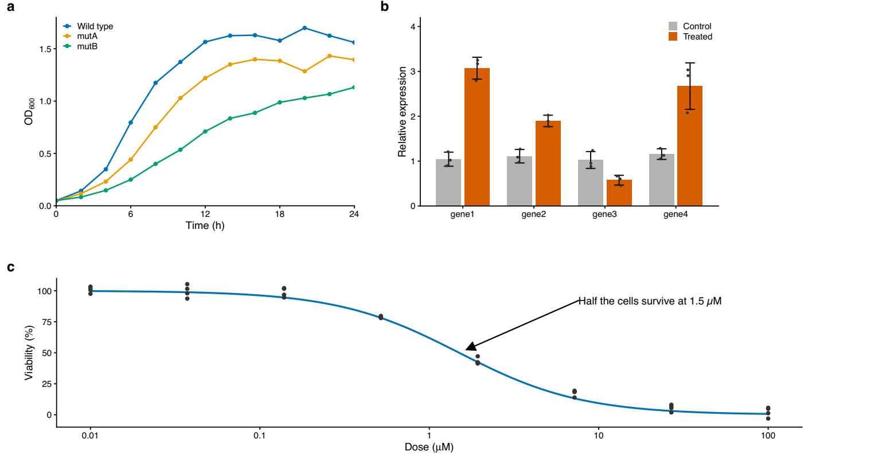

You'll need FigAssemble installed (see [Install](../README.md#install)) and the three sample
plots from the **`examples`** folder in the FigAssemble folder you downloaded. If you deleted that
folder, download the ZIP again.

The sample plots were made in R and saved the usual way: each one as a **PDF**, an **SVG** and a
**PNG** under the same name. FigAssemble finds all three copies and uses the right one for each
kind of export. (The data are made up; [`examples/make_examples.R`](../examples/make_examples.R)
draws them.)

Shortcuts are written for a Mac. On Windows use **Ctrl** for **⌘** and **Shift** for **⇧**.

## 1. A quick look around

Open FigAssemble. Here's the window with a finished figure in it:

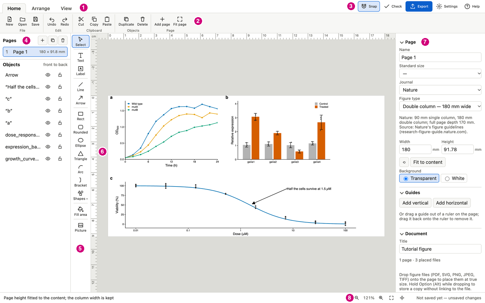

1. **Tabs**, like PowerPoint's ribbon: **Home** (files, undo, clipboard, pages, swatches and
   styles), **Arrange** (align, distribute, match sizes, group, order), **Figure** (scale bars,
   zoom insets, significance brackets), **Combine** (Pathfinder, clipping masks) and **View**
   (zoom, rulers, grid, guides, colour vision preview).
2. **The tab's commands**, in labelled groups.
3. **Always in view:** **Snap** (switches snapping on and off), **Check** (looks for problems
   before exporting), **Export**, **Settings** (units, themes and more) and **Help** (all keyboard
   shortcuts).
4. **Pages and Objects.** A document can have several pages; Objects lists everything on the
   current page, front to back, with buttons to hide or lock each one. Drag a row up or down to
   put that object in front of or behind the others.
5. **Drawing tools:** Select, Text, panel Label, Line, Arrow, shapes, the **Shapes** menu of
   PowerPoint's shapes, **Fill area** (fills a space lines enclose) and Picture.
6. **The page**, with rulers along the top and left.
7. **Properties** of whatever is selected, in tabs (Arrange, Style, Text, Picture). With nothing
   selected, it shows the page. Click a section's heading to fold it away.
8. **Zoom.** Pinch, or ⌘ + scroll, also zooms; scroll or Space + drag moves around. While the
   whole page fits in the view, it stays centred; after zooming in, the **Centre** button (⌘⇧0)
   brings it back to the middle.

Every button has a tooltip with its keyboard shortcut. Press **?** for the full list. Right-click
an object or the page (Control-click on a Mac) for a menu of what you can do with it.

## 2. Choose the page size

A new document starts with an A4 page. To make it a Nature double-column figure:

1. Click an empty part of the grey area around the page (or press Escape) so nothing is
   selected. The panel on the right now shows the **Page**.
2. Set **Journal** to **Nature**.
3. Set **Figure type** to **Double column**.

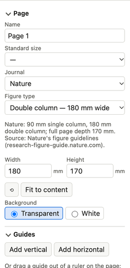

The page is now 180 mm wide, Nature's double-column width, and 170 mm tall, the most a Nature
figure may be. The note under the dropdowns gives the journal's sizes and where they come from.
You'll shrink the height to fit the figure at the end.

## 3. Place the plots

Open the `examples` folder in Finder (Explorer on Windows) and drag **`growth_curves.pdf`**,
**`expression_bars.pdf`** and **`dose_response.pdf`** onto the page. Or select the three files,
copy them (⌘C) and paste them into FigAssemble (⌘V), or click **Picture** at the bottom of the
tools and choose them.

They land at **true size**: 100%, exactly as R saved them, so their 6 pt text is still 6 pt. Drag
them apart if they overlap, then click one to see what FigAssemble knows about it:

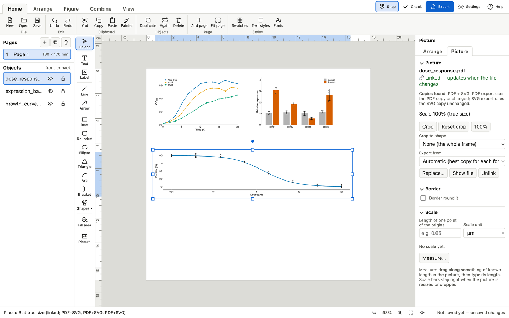

The **Picture** tab says:

- **Linked — updates when the file changes.** If you re-run the R code that made the plot,
  the panel updates by itself, keeping its place and size.
- **Copies found: PDF + SVG.** It found the plot's other copies, and the PDF export will use the
  PDF copy unchanged while the SVG export uses the SVG copy unchanged.
- **Scale 100% (true size).** If you resize a plot, this shows the new scale and warns that its
  text has shrunk or grown with it.

## 4. Arrange them

Drag the growth curves to the top-left corner of the page, then drag the bar chart to its right.
As you drag, **magenta lines** appear when edges or centres line up with another object, the page
or a guide, and the object snaps into line:

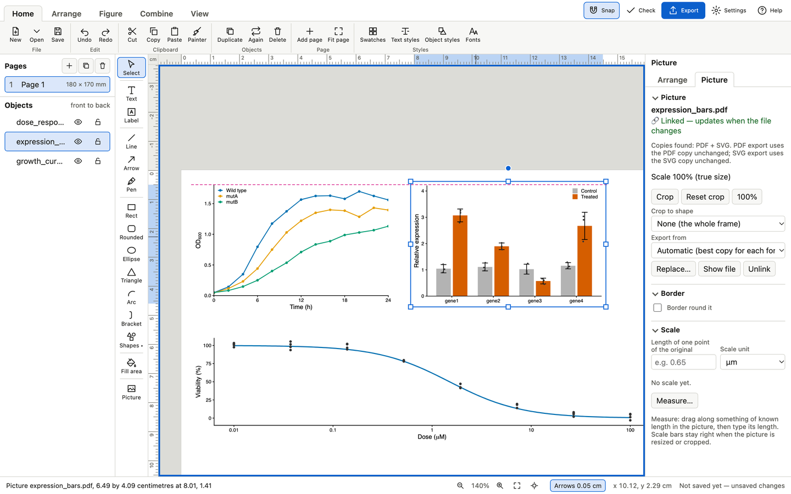

Snapping is quick to get out of the way:

- **Hold ⌘** while you drag to place something freely, just that once.
- Click **Snap** at the top right to turn snapping off until you turn it back on (⌘⇧;).
- Press **Escape** while dragging to put the object back where it was.

Now drag the dose-response plot below the other two.

To line up several objects at once, select them (click one, then **⌘**-click the others; on
Windows, **Ctrl**-click; **Shift**-click works too) and open the **Arrange** tab. Try **Top** under *Align* with the top two selected:

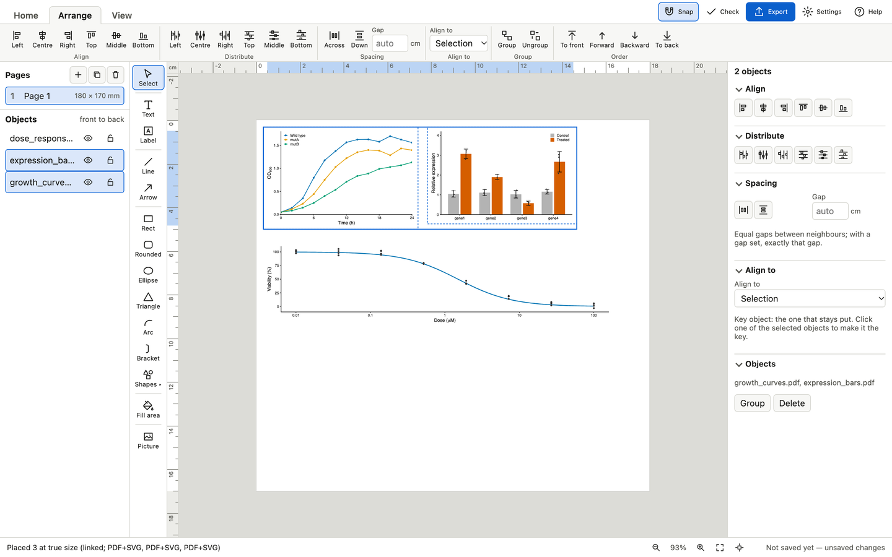

The Arrange tab and the panel on the right have the same controls:

- **Align**: left edges, centres, right edges, tops, middles or bottoms.
- **Distribute**: spreads three or more objects so their left edges (or centres, or right
  edges…) are evenly spaced.
- **Spacing**: equal gaps between neighbours. Type a **Gap** (say `0.3` cm) to get exactly that
  gap instead.
- **Align to**: the selection, the **page**, or a **key object** that stays put. Click one of the
  selected objects to make it the key; it gets a thick outline.

For exact positions, select an object and type its **X** and **Y** in the **Arrange** tab on the
right. Positions are in centimetres from the page's top-left corner, like the rulers. Arrow keys
also move a selected object, 10 times as far with Shift. Each press moves a round amount that
shrinks as you zoom in (0.05 cm at 100%, 0.01 cm at 400%), shown at the bottom of the window.

Once panels sit where you want them, you can keep them together. Select the top two plots,
right-click one of them and choose **Group**, or press **⌘G**:

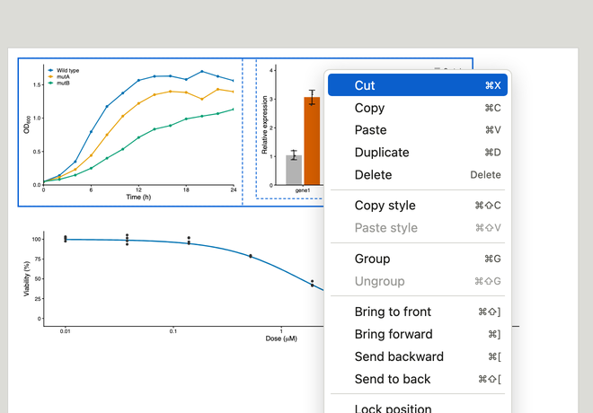

A group moves, lines up and resizes as one object; **Ungroup** (⌘⇧G) takes it apart again. The
right-click menu has the everyday commands for whatever you click, each with its shortcut: copy
and paste, order, lock and hide, and for a picture, crop and replace. Right-click empty page for
the page's own commands.

## 5. Add panel labels

Press **P** (the **Label** tool) and click just above the top-left corner of the growth curves:
an **a** appears, in bold 8 pt Helvetica. Press **P** again and click above the bar chart for
**b**, then above the dose-response plot for **c**. FigAssemble picks the next unused letter each
time.

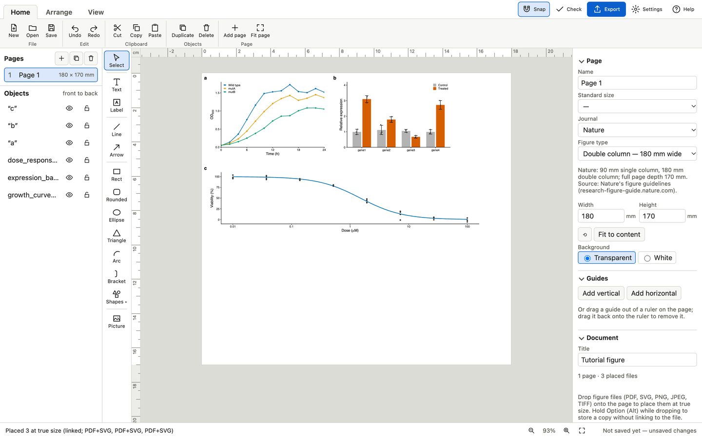

Each label stays with the plot it's next to: move or resize a plot and its label goes along.
To change a label, double-click it and type. The labels' size, style and case (a, b, c or A, B, C)
are in **Settings**.

## 6. Add a note with an arrow

1. Press **T** (Text), click to the right of the curve's middle, and type
   `Half the cells survive at 1.5 µM`. Press **Escape** to finish.
2. Press **A** (Arrow). Move the pointer over the note: small blue points appear at its corners
   and side middles. Press on the point in the middle of its left side and drag to the curve.

The arrow's start is now **attached** to the note: its end handle shows green, and the
**Connections** section of the arrow's **Arrange** tab says what it's attached to:

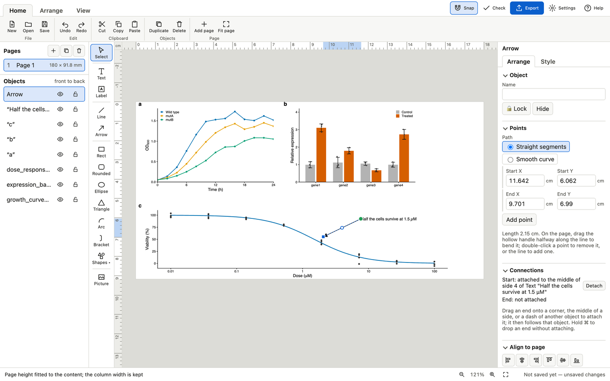

Drag the note somewhere else and the arrow follows. You can attach either end of any line or arrow
to the corners and side middles of shapes, pictures and text, to the ends and middle of other
lines, and to the dashes of dashed outlines. Hold ⌘ while dropping an end to leave it unattached.

The arrow's **Style** tab sets its width, colour, dashes and arrowheads:

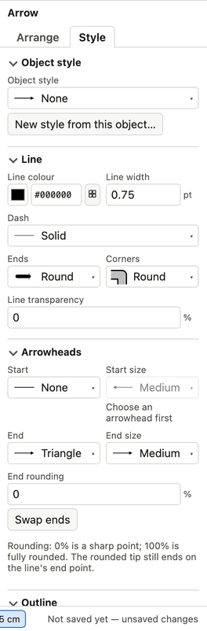

## 7. Fit the page and check it

In the **Home** tab, click **Fit page**. The page shrinks to the figure's height. On a journal
page it keeps the column width, so the figure stays exactly 180 mm wide.

Now click **Check** at the top right. It lists anything a journal might object to:

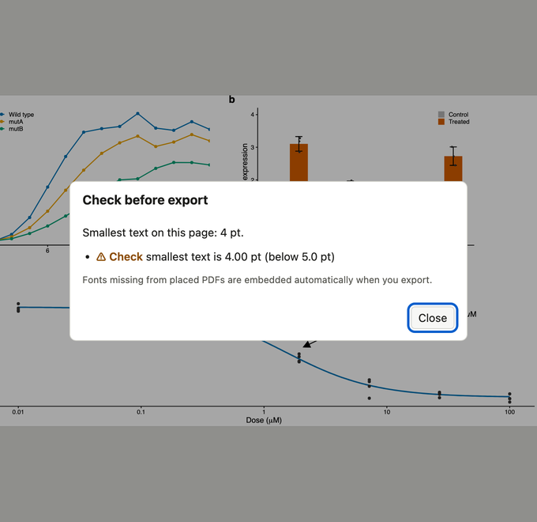

Here it found text smaller than 5 pt: the little *600* in *OD₆₀₀*. Many journals ask for at least
5 pt, so you'd fix that in the R code, and the panel would update by itself. The thinnest line,
0.58 pt, is fine (lines thinner than 0.25 pt get flagged), and the page fits Nature's double column
size. Check also reports low-resolution images, placed files that can't be found, and any
conversion an export would need.

## 8. Export

Click **Export** (⌘E). Choose the formats you want: say **PDF**, and **PNG** at **600 dpi**. Then
click **Export…** and choose where to save them.

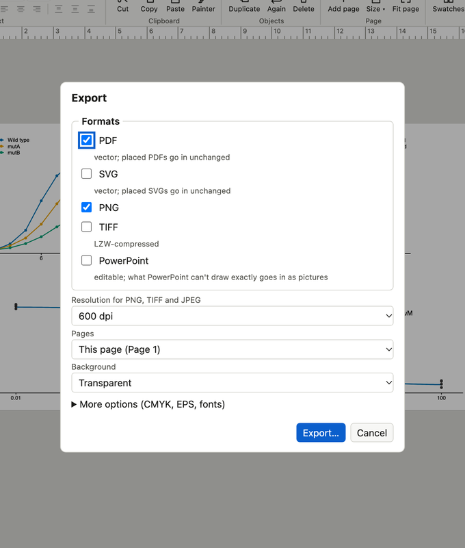

- The **PDF** contains the placed PDFs unchanged, so everything stays sharp at any zoom, and the
  fonts R left out are embedded. This is usually the file a journal wants.
- The **SVG** contains the placed SVGs unchanged, so it can be edited in Illustrator or Inkscape.
- **PNG** and **TIFF** are drawn once, straight from the vectors, at the resolution you choose.
- **More options** has JPEG, EPS and CMYK, for journals that ask for them.

## 9. Save it

Press **⌘S** to save the document as a `.figasm` file. It keeps the links to your plot files and
a copy of each one too, so you can send it to a labmate and it opens complete. If a linked file
has moved, FigAssemble uses the stored copy and the Picture tab says so. To come back to it,
double-click the file in Finder or Explorer. Each figure opens in a window of its own, so you
can have the next one open beside it.

If FigAssemble ever closes unexpectedly, it offers your unsaved work back the next time it starts.

## Where next

- The **[user guide](guide.md)** covers everything else: cropping pictures (to a shape too),
  scale bars, zoom insets, significance brackets, swatches and text styles, copying a style,
  curved arrows, the Shapes menu, gradient fills, outlines, area fills, combining shapes,
  clipping masks, editing inside groups, guides and the grid, checking colours for colour-blind
  readers, themes, bringing in PowerPoint slides, and all the keyboard shortcuts.
- Try it with your own figures, and **tell us what's confusing or missing**:
  [report a problem](https://github.com/matthewwdavis/FigAssemble/issues/new?template=problem.yml)
  or [suggest an idea](https://github.com/matthewwdavis/FigAssemble/issues/new?template=idea.yml).
